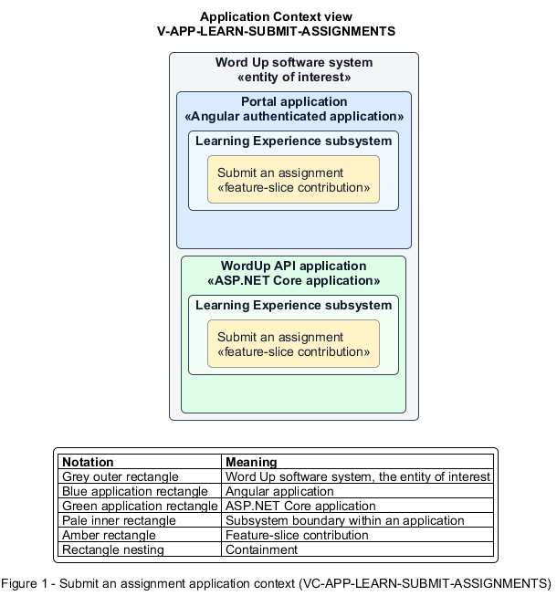

# Submit an assignment

## Identification and scope

The Word Up software system is the entity of interest (EoI). The Submit an assignment feature slice (`FS-LEARN-SUBMIT-ASSIGNMENTS`) is an architecture description element in the Learning Experience subsystem.

| Item | Identification |
| --- | --- |
| Participating applications | Portal application; WordUp API application |
| Architecture view | Application Context view (`V-APP-LEARN-SUBMIT-ASSIGNMENTS`) |
| Governing viewpoint | Application Context viewpoint (`VP-APP-CONTEXT`) |
| View component | Nested Application Context component (`VC-APP-LEARN-SUBMIT-ASSIGNMENTS`) |

This focused description addresses feature scope, behavior, application context, and requirement correspondences. It does not claim conformance as a complete architecture description.

## Overview

The Submit an assignment feature slice allows a youth understand an assignment and submit allowed evidence with an attestation.

## Application context

The Application Context view (`V-APP-LEARN-SUBMIT-ASSIGNMENTS`) applies the Application Context viewpoint (`VP-APP-CONTEXT`) to the Word Up software system. The viewpoint frames the application-location concern (`C-APP-LOCATION`). The view component (`VC-APP-LEARN-SUBMIT-ASSIGNMENTS`) uses the nested-containment model kind.

Nested rectangles identify the EoI, each participating application, the subsystem boundary, and the feature-slice contribution. Figure 1 presents the view component.

*Figure 1 — Application Context view: the Submit an assignment feature slice within the participating Word Up applications.*

## Behavior

- **Entry.** A youth opens an assigned brief and chooses a supported submission type.
- **Processing.** The page presents the task, due time, and rubric. The API validates required evidence, safe upload limits, and truthfulness attestation. The API then creates an immutable `Submitted` record.
- **Result.** The youth is routed to a status view and the work is ready for mentor review.

## Scope boundary

Grading and post-submission revision are separate slices.

## Correspondences

The requirement-trace correspondence method (`M-REQ-TRACE`) relates stable L2 requirement identifiers to feature slices. The Submit an assignment requirement correspondence (`COR-REQ-LEARN-SUBMIT-ASSIGNMENTS`) records the following relationships.

| Requirement | Relationship |
| --- | --- |
| `L2-LEARN-006` | Primary requirement |
| `L2-CURRIC-004` | Dependency |
| `L2-NFR-001` | Dependency |
