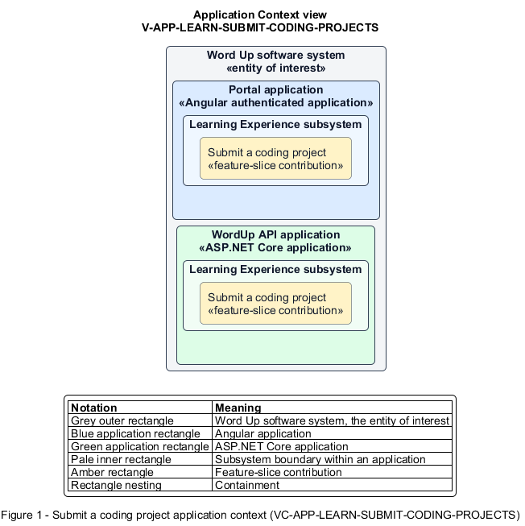

# Submit a coding project

## Identification and scope

The Word Up software system is the entity of interest (EoI). The Submit a coding project feature slice (`FS-LEARN-SUBMIT-CODING-PROJECTS`) is an architecture description element in the Learning Experience subsystem.

| Item | Identification |
| --- | --- |
| Participating applications | Portal application; WordUp API application |
| Architecture view | Application Context view (`V-APP-LEARN-SUBMIT-CODING-PROJECTS`) |
| Governing viewpoint | Application Context viewpoint (`VP-APP-CONTEXT`) |
| View component | Nested Application Context component (`VC-APP-LEARN-SUBMIT-CODING-PROJECTS`) |

This focused description addresses feature scope, behavior, application context, and requirement correspondences. It does not claim conformance as a complete architecture description.

## Overview

The Submit a coding project feature slice allows a youth send a coding project and optional mentor note into the standard review lifecycle.

## Application context

The Application Context view (`V-APP-LEARN-SUBMIT-CODING-PROJECTS`) applies the Application Context viewpoint (`VP-APP-CONTEXT`) to the Word Up software system. The viewpoint frames the application-location concern (`C-APP-LOCATION`). The view component (`VC-APP-LEARN-SUBMIT-CODING-PROJECTS`) uses the nested-containment model kind.

Nested rectangles identify the EoI, each participating application, the subsystem boundary, and the feature-slice contribution. Figure 1 presents the view component.

*Figure 1 — Application Context view: the Submit a coding project feature slice within the participating Word Up applications.*

## Behavior

- **Entry.** A youth opens an assigned coding project and provides the required project evidence.
- **Processing.** The server validates and stores the project submission plus optional note, applies the same immutability and authorization rules as other assignments, and creates Under review status.
- **Result.** The project appears in the mentor review queue and the youth can track its outcome.

## Scope boundary

Interactive coding lessons and mentor grading are separate slices.

## Correspondences

The requirement-trace correspondence method (`M-REQ-TRACE`) relates stable L2 requirement identifiers to feature slices. The Submit a coding project requirement correspondence (`COR-REQ-LEARN-SUBMIT-CODING-PROJECTS`) records the following relationships.

| Requirement | Relationship |
| --- | --- |
| `L2-LEARN-008` | Primary requirement |
| `L2-LEARN-006` | Dependency |
| `L2-LEARN-007` | Dependency |
