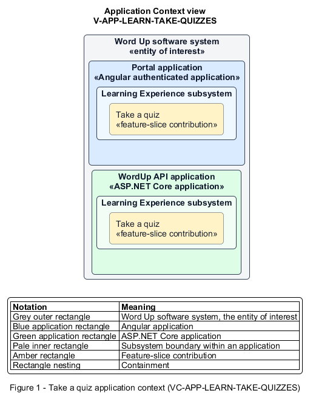

# Take a quiz

## Identification and scope

The Word Up software system is the entity of interest (EoI). The Take a quiz feature slice (`FS-LEARN-TAKE-QUIZZES`) is an architecture description element in the Learning Experience subsystem.

| Item | Identification |
| --- | --- |
| Participating applications | Portal application; WordUp API application |
| Architecture view | Application Context view (`V-APP-LEARN-TAKE-QUIZZES`) |
| Governing viewpoint | Application Context viewpoint (`VP-APP-CONTEXT`) |
| View component | Nested Application Context component (`VC-APP-LEARN-TAKE-QUIZZES`) |

This focused description addresses feature scope, behavior, application context, and requirement correspondences. It does not claim conformance as a complete architecture description.

## Overview

The Take a quiz feature slice allows a youth begin, resume, and immutably submit one quiz attempt within configured limits.

## Application context

The Application Context view (`V-APP-LEARN-TAKE-QUIZZES`) applies the Application Context viewpoint (`VP-APP-CONTEXT`) to the Word Up software system. The viewpoint frames the application-location concern (`C-APP-LOCATION`). The view component (`VC-APP-LEARN-TAKE-QUIZZES`) uses the nested-containment model kind.

Nested rectangles identify the EoI, each participating application, the subsystem boundary, and the feature-slice contribution. Figure 1 presents the view component.

*Figure 1 — Application Context view: the Take a quiz feature slice within the participating Word Up applications.*

## Behavior

- **Entry.** A youth opens an unlocked quiz intro and starts an available attempt.
- **Processing.** The Portal application presents rules, delivers one question at a time, autosaves online answers and position, and confirms final submission. The server enforces attempt limits, scores against authored answers, and freezes submitted responses.
- **Result.** A finalized attempt has a deterministic score and the correct best-passing recorded score.

## Scope boundary

How results and answer feedback are revealed is a separate slice.

## Correspondences

The requirement-trace correspondence method (`M-REQ-TRACE`) relates stable L2 requirement identifiers to feature slices. The Take a quiz requirement correspondence (`COR-REQ-LEARN-TAKE-QUIZZES`) records the following relationships.

| Requirement | Relationship |
| --- | --- |
| `L2-LEARN-004` | Primary requirement |
| `L2-CURRIC-003` | Dependency |
