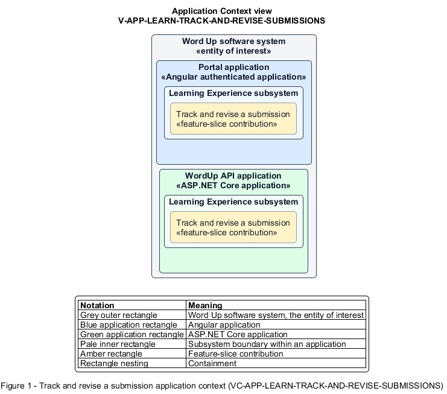

# Track and revise a submission

## Identification and scope

The Word Up software system is the entity of interest (EoI). The Track and revise a submission feature slice (`FS-LEARN-TRACK-AND-REVISE-SUBMISSIONS`) is an architecture description element in the Learning Experience subsystem.

| Item | Identification |
| --- | --- |
| Participating applications | Portal application; WordUp API application |
| Architecture view | Application Context view (`V-APP-LEARN-TRACK-AND-REVISE-SUBMISSIONS`) |
| Governing viewpoint | Application Context viewpoint (`VP-APP-CONTEXT`) |
| View component | Nested Application Context component (`VC-APP-LEARN-TRACK-AND-REVISE-SUBMISSIONS`) |

This focused description addresses feature scope, behavior, application context, and requirement correspondences. It does not claim conformance as a complete architecture description.

## Overview

The Track and revise a submission feature slice allows a youth follow mentor review and respond when revision is requested.

## Application context

The Application Context view (`V-APP-LEARN-TRACK-AND-REVISE-SUBMISSIONS`) applies the Application Context viewpoint (`VP-APP-CONTEXT`) to the Word Up software system. The viewpoint frames the application-location concern (`C-APP-LOCATION`). The view component (`VC-APP-LEARN-TRACK-AND-REVISE-SUBMISSIONS`) uses the nested-containment model kind.

Nested rectangles identify the EoI, each participating application, the subsystem boundary, and the feature-slice contribution. Figure 1 presents the view component.

*Figure 1 — Application Context view: the Track and revise a submission feature slice within the participating Word Up applications.*

## Behavior

- **Entry.** A youth opens a previously submitted assignment or receives a status-change notification.
- **Processing.** The Portal application renders the submission and lifecycle timeline. The Approved state presents points, a badge, and a comment. The Needs Revision state presents the mentor note and accepts a replacement submission that returns to Under Review.
- **Result.** The youth always sees the current review outcome and can complete the revision loop.

## Scope boundary

Creating the first submission and performing mentor grading are separate slices.

## Correspondences

The requirement-trace correspondence method (`M-REQ-TRACE`) relates stable L2 requirement identifiers to feature slices. The Track and revise a submission requirement correspondence (`COR-REQ-LEARN-TRACK-AND-REVISE-SUBMISSIONS`) records the following relationships.

| Requirement | Relationship |
| --- | --- |
| `L2-LEARN-007` | Primary requirement |
| `L2-MENTOR-003` | Dependency |
| `L2-NFR-005` | Dependency |
