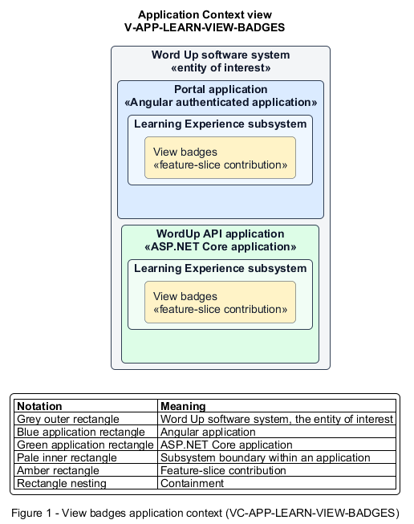

# View badges

## Identification and scope

The Word Up software system is the entity of interest (EoI). The View badges feature slice (`FS-LEARN-VIEW-BADGES`) is an architecture description element in the Learning Experience subsystem.

| Item | Identification |
| --- | --- |
| Participating applications | Portal application; WordUp API application |
| Architecture view | Application Context view (`V-APP-LEARN-VIEW-BADGES`) |
| Governing viewpoint | Application Context viewpoint (`VP-APP-CONTEXT`) |
| View component | Nested Application Context component (`VC-APP-LEARN-VIEW-BADGES`) |

This focused description addresses feature scope, behavior, application context, and requirement correspondences. It does not claim conformance as a complete architecture description.

## Overview

The View badges feature slice allows a youth explore earned badges, locked criteria, and milestone progress.

## Application context

The Application Context view (`V-APP-LEARN-VIEW-BADGES`) applies the Application Context viewpoint (`VP-APP-CONTEXT`) to the Word Up software system. The viewpoint frames the application-location concern (`C-APP-LOCATION`). The view component (`VC-APP-LEARN-VIEW-BADGES`) uses the nested-containment model kind.

Nested rectangles identify the EoI, each participating application, the subsystem boundary, and the feature-slice contribution. Figure 1 presents the view component.

*Figure 1 — Application Context view: the View badges feature slice within the participating Word Up applications.*

## Behavior

- **Entry.** A youth opens Badges or follows a badge-earned notification.
- **Processing.** The server returns earned dates and canonical counted progress for locked criteria; the UI presents earned and locked collections plus a milestone timeline consistently with home, journey, and profile.
- **Result.** The youth can celebrate achievements and understand how to unlock the next badge.

## Scope boundary

Defining and awarding badges remain Curriculum Authoring responsibilities.

## Correspondences

The requirement-trace correspondence method (`M-REQ-TRACE`) relates stable L2 requirement identifiers to feature slices. The View badges requirement correspondence (`COR-REQ-LEARN-VIEW-BADGES`) records the following relationships.

| Requirement | Relationship |
| --- | --- |
| `L2-LEARN-009` | Primary requirement |
| `L2-CURRIC-005` | Dependency |
