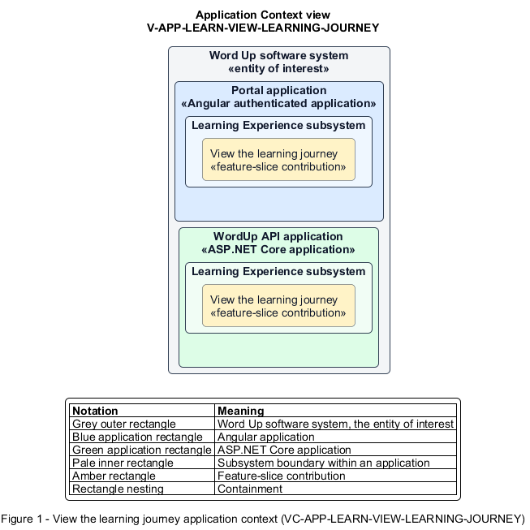

# View the learning journey

## Identification and scope

The Word Up software system is the entity of interest (EoI). The View the learning journey feature slice (`FS-LEARN-VIEW-LEARNING-JOURNEY`) is an architecture description element in the Learning Experience subsystem.

| Item | Identification |
| --- | --- |
| Participating applications | Portal application; WordUp API application |
| Architecture view | Application Context view (`V-APP-LEARN-VIEW-LEARNING-JOURNEY`) |
| Governing viewpoint | Application Context viewpoint (`VP-APP-CONTEXT`) |
| View component | Nested Application Context component (`VC-APP-LEARN-VIEW-LEARNING-JOURNEY`) |

This focused description addresses feature scope, behavior, application context, and requirement correspondences. It does not claim conformance as a complete architecture description.

## Overview

The View the learning journey feature slice provides a youth a roadmap of completed, current, and locked modules.

## Application context

The Application Context view (`V-APP-LEARN-VIEW-LEARNING-JOURNEY`) applies the Application Context viewpoint (`VP-APP-CONTEXT`) to the Word Up software system. The viewpoint frames the application-location concern (`C-APP-LOCATION`). The view component (`VC-APP-LEARN-VIEW-LEARNING-JOURNEY`) uses the nested-containment model kind.

Nested rectangles identify the EoI, each participating application, the subsystem boundary, and the feature-slice contribution. Figure 1 presents the view component.

*Figure 1 — Application Context view: the View the learning journey feature slice within the participating Word Up applications.*

## Behavior

- **Entry.** A youth opens Journey.
- **Processing.** The server derives module status and completion counts from the canonical progress source, while the UI highlights the current module and explains locked and completed steps.
- **Result.** The youth understands where they are and which curriculum milestone comes next.

## Scope boundary

The detailed badge collection and curriculum-item interaction are separate slices.

## Correspondences

The requirement-trace correspondence method (`M-REQ-TRACE`) relates stable L2 requirement identifiers to feature slices. The View the learning journey requirement correspondence (`COR-REQ-LEARN-VIEW-LEARNING-JOURNEY`) records the following relationships.

| Requirement | Relationship |
| --- | --- |
| `L2-LEARN-009` | Primary requirement |
| `L2-LEARN-001` | Dependency |
