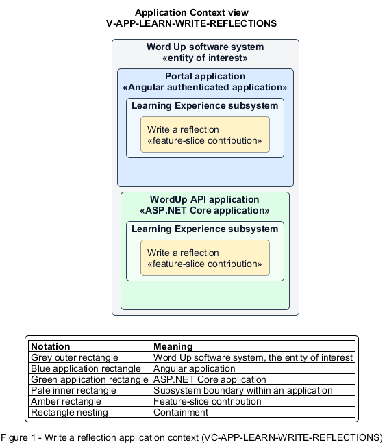

# Write a reflection

## Identification and scope

The Word Up software system is the entity of interest (EoI). The Write a reflection feature slice (`FS-LEARN-WRITE-REFLECTIONS`) is an architecture description element in the Learning Experience subsystem.

| Item | Identification |
| --- | --- |
| Participating applications | Portal application; WordUp API application |
| Architecture view | Application Context view (`V-APP-LEARN-WRITE-REFLECTIONS`) |
| Governing viewpoint | Application Context viewpoint (`VP-APP-CONTEXT`) |
| View component | Nested Application Context component (`VC-APP-LEARN-WRITE-REFLECTIONS`) |

This focused description addresses feature scope, behavior, application context, and requirement correspondences. It does not claim conformance as a complete architecture description.

## Overview

The Write a reflection feature slice allows a youth capture a lesson reflection and deliberately choose its privacy.

## Application context

The Application Context view (`V-APP-LEARN-WRITE-REFLECTIONS`) applies the Application Context viewpoint (`VP-APP-CONTEXT`) to the Word Up software system. The viewpoint frames the application-location concern (`C-APP-LOCATION`). The view component (`VC-APP-LEARN-WRITE-REFLECTIONS`) uses the nested-containment model kind.

Nested rectangles identify the EoI, each participating application, the subsystem boundary, and the feature-slice contribution. Figure 1 presents the view component.

*Figure 1 — Application Context view: the Write a reflection feature slice within the participating Word Up applications.*

## Behavior

- **Entry.** A youth arrives after a lesson or reopens a reflection draft.
- **Processing.** The form requires primary text and captures mood and optional prompts. Sharing defaults to off. The Portal application warns before unsaved navigation and saves and restores drafts. The API grants mentor access only after explicit sharing.
- **Result.** The API persists a private or shared reflection with the youth's intended visibility.

## Scope boundary

Mentor replies occur through check-ins rather than editing the reflection.

## Correspondences

The requirement-trace correspondence method (`M-REQ-TRACE`) relates stable L2 requirement identifiers to feature slices. The Write a reflection requirement correspondence (`COR-REQ-LEARN-WRITE-REFLECTIONS`) records the following relationships.

| Requirement | Relationship |
| --- | --- |
| `L2-LEARN-003` | Primary requirement |
| `L2-NFR-007` | Dependency |
| `L2-AUTH-010` | Dependency |
