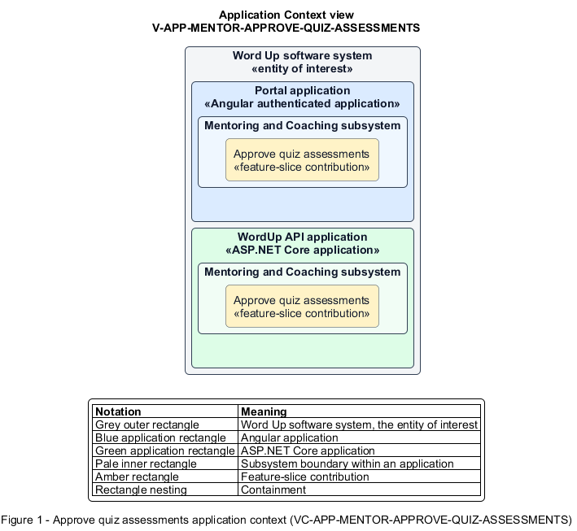

# Approve quiz assessments

## Identification and scope

The Word Up software system is the entity of interest (EoI). The Approve quiz assessments feature slice (`FS-MENTOR-APPROVE-QUIZ-ASSESSMENTS`) is an architecture description element in the Mentoring and Coaching subsystem.

| Item | Identification |
| --- | --- |
| Participating applications | Portal application; WordUp API application |
| Architecture view | Application Context view (`V-APP-MENTOR-APPROVE-QUIZ-ASSESSMENTS`) |
| Governing viewpoint | Application Context viewpoint (`VP-APP-CONTEXT`) |
| View component | Nested Application Context component (`VC-APP-MENTOR-APPROVE-QUIZ-ASSESSMENTS`) |

This focused description addresses feature scope, behavior, application context, and requirement correspondences. It does not claim conformance as a complete architecture description.

## Overview

The Approve quiz assessments feature slice allows mentors validate auto-scored quizzes before scores affect youth progress.

## Application context

The Application Context view (`V-APP-MENTOR-APPROVE-QUIZ-ASSESSMENTS`) applies the Application Context viewpoint (`VP-APP-CONTEXT`) to the Word Up software system. The viewpoint frames the application-location concern (`C-APP-LOCATION`). The view component (`VC-APP-MENTOR-APPROVE-QUIZ-ASSESSMENTS`) uses the nested-containment model kind.

Nested rectangles identify the EoI, each participating application, the subsystem boundary, and the feature-slice contribution. Figure 1 presents the view component.

*Figure 1 — Application Context view: the Approve quiz assessments feature slice within the participating Word Up applications.*

## Behavior

- **Entry.** An authorized mentor opens one pending quiz assessment or selects Approve all within scope.
- **Processing.** The mentor approves the auto-score or enters a bounded override; the server retains original and approved values, records each bulk item, applies only the approved score, and audits overrides.
- **Result.** Progress and youth-visible results use the authoritative approved score.

## Scope boundary

Quiz taking, automatic scoring, and result feedback presentation are separate slices.

## Correspondences

The requirement-trace correspondence method (`M-REQ-TRACE`) relates stable L2 requirement identifiers to feature slices. The Approve quiz assessments requirement correspondence (`COR-REQ-MENTOR-APPROVE-QUIZ-ASSESSMENTS`) records the following relationships.

| Requirement | Relationship |
| --- | --- |
| `L2-MENTOR-004` | Primary requirement |
| `L2-LEARN-005` | Dependency |
| `L2-CONSENT-003` | Dependency |
