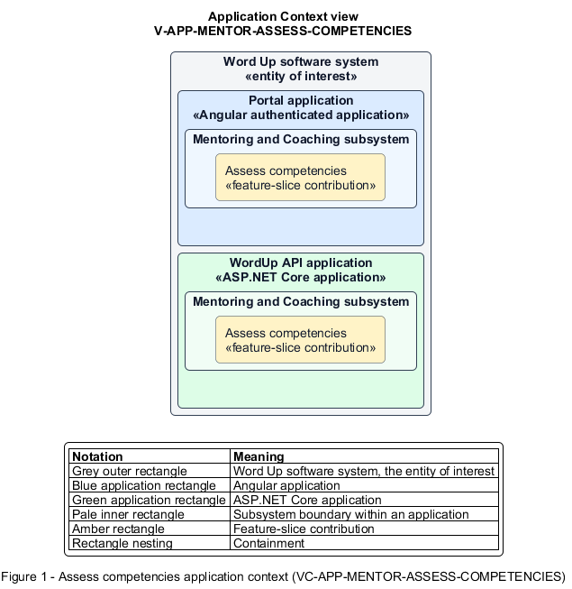

# Assess competencies

## Identification and scope

The Word Up software system is the entity of interest (EoI). The Assess competencies feature slice (`FS-MENTOR-ASSESS-COMPETENCIES`) is an architecture description element in the Mentoring and Coaching subsystem.

| Item | Identification |
| --- | --- |
| Participating applications | Portal application; WordUp API application |
| Architecture view | Application Context view (`V-APP-MENTOR-ASSESS-COMPETENCIES`) |
| Governing viewpoint | Application Context viewpoint (`VP-APP-CONTEXT`) |
| View component | Nested Application Context component (`VC-APP-MENTOR-ASSESS-COMPETENCIES`) |

This focused description addresses feature scope, behavior, application context, and requirement correspondences. It does not claim conformance as a complete architecture description.

## Overview

The Assess competencies feature slice allows a mentor record the latest observable competency level for an assigned youth.

## Application context

The Application Context view (`V-APP-MENTOR-ASSESS-COMPETENCIES`) applies the Application Context viewpoint (`VP-APP-CONTEXT`) to the Word Up software system. The viewpoint frames the application-location concern (`C-APP-LOCATION`). The view component (`VC-APP-MENTOR-ASSESS-COMPETENCIES`) uses the nested-containment model kind.

Nested rectangles identify the EoI, each participating application, the subsystem boundary, and the feature-slice contribution. Figure 1 presents the view component.

*Figure 1 — Application Context view: the Assess competencies feature slice within the participating Word Up applications.*

## Behavior

- **Entry.** A mentor opens the youth's competency tracker and selects a framework competency.
- **Processing.** The form stores Not started, Developing, Proficient, or Mastered with optional notes, assessor, and timestamp, then recomputes the summary against the authored framework.
- **Result.** Youth progress and reports reflect the latest persisted assessment.

## Scope boundary

Creating stages and competencies belongs to Curriculum Authoring.

## Correspondences

The requirement-trace correspondence method (`M-REQ-TRACE`) relates stable L2 requirement identifiers to feature slices. The Assess competencies requirement correspondence (`COR-REQ-MENTOR-ASSESS-COMPETENCIES`) records the following relationships.

| Requirement | Relationship |
| --- | --- |
| `L2-MENTOR-005` | Primary requirement |
| `L2-CURRIC-006` | Dependency |
| `L2-LEARN-010` | Dependency |
