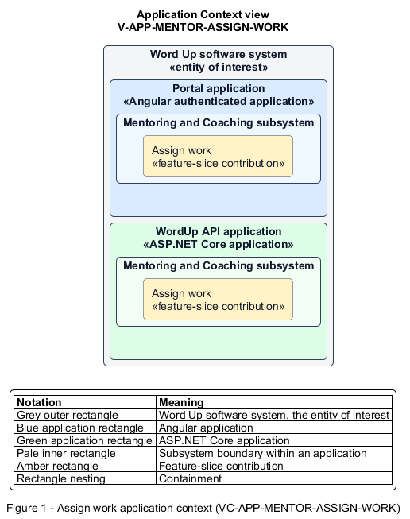

# Assign work

## Identification and scope

The Word Up software system is the entity of interest (EoI). The Assign work feature slice (`FS-MENTOR-ASSIGN-WORK`) is an architecture description element in the Mentoring and Coaching subsystem.

| Item | Identification |
| --- | --- |
| Participating applications | Portal application; WordUp API application |
| Architecture view | Application Context view (`V-APP-MENTOR-ASSIGN-WORK`) |
| Governing viewpoint | Application Context viewpoint (`VP-APP-CONTEXT`) |
| View component | Nested Application Context component (`VC-APP-MENTOR-ASSIGN-WORK`) |

This focused description addresses feature scope, behavior, application context, and requirement correspondences. It does not claim conformance as a complete architecture description.

## Overview

The Assign work feature slice allows a mentor assign an eligible lesson, module, or project to individuals or an entire cohort.

## Application context

The Application Context view (`V-APP-MENTOR-ASSIGN-WORK`) applies the Application Context viewpoint (`VP-APP-CONTEXT`) to the Word Up software system. The viewpoint frames the application-location concern (`C-APP-LOCATION`). The view component (`VC-APP-MENTOR-ASSIGN-WORK`) uses the nested-containment model kind.

Nested rectangles identify the EoI, each participating application, the subsystem boundary, and the feature-slice contribution. Figure 1 presents the view component.

*Figure 1 — Application Context view: the Assign work feature slice within the participating Word Up applications.*

## Behavior

- **Entry.** A mentor chooses work type and item, recipients, and optional due date, reminder cadence, and message.
- **Processing.** The server verifies mentor scope, creates one AssignedWork record per recipient, schedules reminders, and delivers the optional text as personal in-app messages.
- **Result.** The reported recipient count receives work in their learning journeys.

## Scope boundary

Authoring the work and completing it remain separate vertical slices.

## Correspondences

The requirement-trace correspondence method (`M-REQ-TRACE`) relates stable L2 requirement identifiers to feature slices. The Assign work requirement correspondence (`COR-REQ-MENTOR-ASSIGN-WORK`) records the following relationships.

| Requirement | Relationship |
| --- | --- |
| `L2-MENTOR-008` | Primary requirement |
| `L2-ENGAGE-008` | Dependency |
| `L2-ENGAGE-007` | Dependency |
