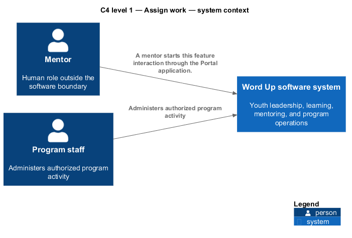
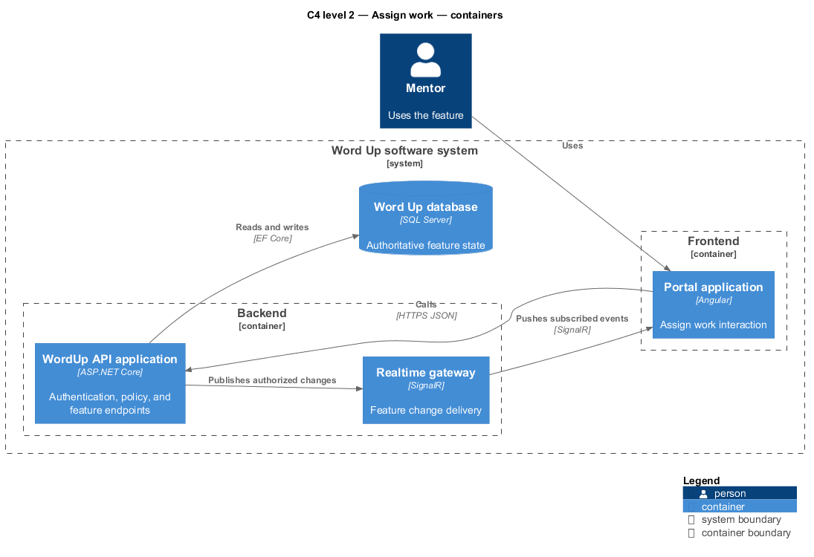
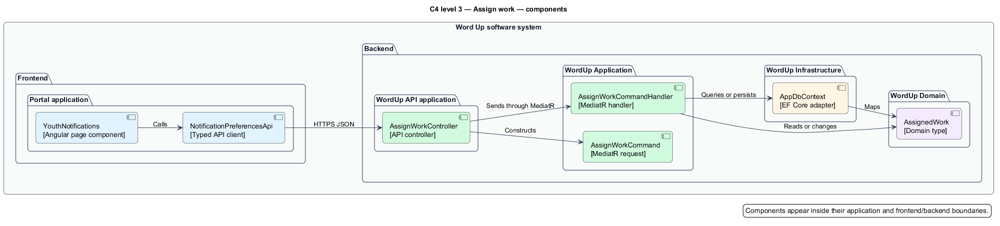
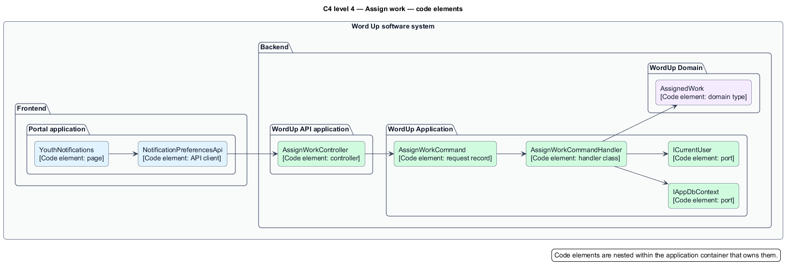
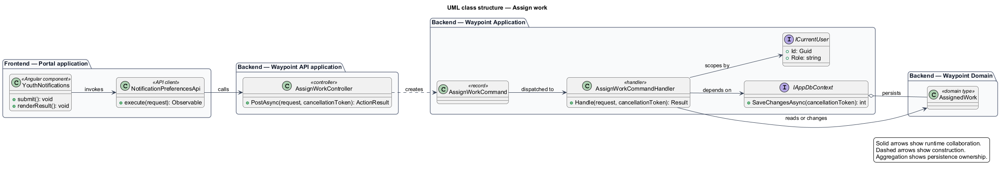
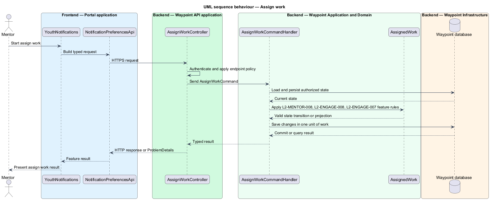

# Assign work — Detailed design

## Overview

Assign work — vertical slice that refines `L2-MENTOR-008` into one independently deliverable interaction. Mentors shall assign lessons/modules/projects to individuals or a whole cohort with due date, reminder, and message.

Word Up is a youth-leadership software system for program intake, learning, mentoring, safeguarding, and program operations. The Mentoring and Coaching subsystem owns this feature slice.

A mentor starts this feature interaction through the Portal application. The backend commits an authorized state change when applicable, and the frontend application presents the authoritative feature result.

The entity of interest (EoI) is the Word Up software system. This focused architecture description (AD) describes the Assign work vertical slice and does not claim full conformance with 42010:2022.

## Description

### Components, types, functions, and classes

| Element | Kind | Source | Responsibility and public interface |
| --- | --- | --- | --- |
| `YouthNotifications` | Frontend page | [`../../../../frontend/projects/portal/src/app/features/youth/notifications/youth-notifications.ts`](../../../../frontend/projects/portal/src/app/features/youth/notifications/youth-notifications.ts) | Collects feature input, invokes the typed client, and renders loading, success, empty, forbidden, and error states. |
| `SettingsNotifications` | Frontend page | [`../../../../frontend/projects/portal/src/app/settings/notifications/settings-notifications.ts`](../../../../frontend/projects/portal/src/app/settings/notifications/settings-notifications.ts) | Collects feature input, invokes the typed client, and renders loading, success, empty, forbidden, and error states. |
| `NotificationPreferencesApi` | Frontend API boundary | [`../../../../frontend/projects/wu-api/src/lib/services/notification-preferences-api.ts`](../../../../frontend/projects/wu-api/src/lib/services/notification-preferences-api.ts) | Serializes requests, deserializes typed results, and maps safe API errors for the page. |
| `AssignWorkController` | API transport | [`../../../../backend/src/WordUp.Api/Controllers/Mentoring/AssignWorkController.cs`](../../../../backend/src/WordUp.Api/Controllers/Mentoring/AssignWorkController.cs) | Applies endpoint authentication and policy, maps request contracts, and sends the application request through MediatR. |
| `AssignWorkCommand` | Application slice | [`../../../../backend/src/WordUp.Application/Mentoring/AssignWork/AssignWorkCommand.cs`](../../../../backend/src/WordUp.Application/Mentoring/AssignWork/AssignWorkCommand.cs) | Coordinates the use case, performs resource-level scoping, invokes domain behavior, and returns the result. |
| `AssignWorkCommandHandler` | Application slice | [`../../../../backend/src/WordUp.Application/Mentoring/AssignWork/AssignWorkCommandHandler.cs`](../../../../backend/src/WordUp.Application/Mentoring/AssignWork/AssignWorkCommandHandler.cs) | Coordinates the use case, performs resource-level scoping, invokes domain behavior, and returns the result. |
| `AssignWorkCommandValidator` | Application slice | [`../../../../backend/src/WordUp.Application/Mentoring/AssignWork/AssignWorkCommandValidator.cs`](../../../../backend/src/WordUp.Application/Mentoring/AssignWork/AssignWorkCommandValidator.cs) | Coordinates the use case, performs resource-level scoping, invokes domain behavior, and returns the result. |
| `AssignWorkResult` | Application slice | [`../../../../backend/src/WordUp.Application/Mentoring/AssignWork/AssignWorkCommand.cs`](../../../../backend/src/WordUp.Application/Mentoring/AssignWork/AssignWorkCommand.cs) | Coordinates the use case, performs resource-level scoping, invokes domain behavior, and returns the result. |
| `AssignedWork` | Domain state | [`../../../../backend/src/WordUp.Domain/Mentoring/AssignedWork.cs`](../../../../backend/src/WordUp.Domain/Mentoring/AssignedWork.cs) | Holds persistent state and lifecycle invariants used by the feature. |
| `ICurrentUser` | Infrastructure and shared ports | [`../../../../backend/src/WordUp.Application/Shared/Abstractions/ICurrentUser.cs`](../../../../backend/src/WordUp.Application/Shared/Abstractions/ICurrentUser.cs) | Supplies persistence, current-user context, time, audit, email, or realtime adapters when the feature requires them. |

### Structure and relationships

- The feature spans Portal application; WordUp API application. The frontend application owns interaction state and presentation. The WordUp API application remains authoritative for authentication, authorization, validation, domain rules, and persisted state. Adjacent subsystem feature slices own behavior outside this end-to-end outcome.

- `YouthNotifications.submit()` starts the browser interaction and maintains presentation state.

- `NotificationPreferencesApi.execute()` crosses the frontend-to-backend boundary with a typed HTTP request.

- `AssignWorkController.PostAsync()` applies transport policy and constructs `AssignWorkCommand`.

- `AssignWorkCommandHandler.Handle()` loads authorized state through `IAppDbContext`, applies feature rules through `AssignedWork`, and returns a typed result.

- `IAppDbContext.SaveChangesAsync()` commits one unit of work when the feature changes state. Read-only flows use bounded, no-tracking projections.

### Behaviour

1. A mentor starts this feature interaction through the Portal application.

2. The frontend application captures the interaction and sends a typed request to the WordUp API application. The controller applies endpoint policy. The application handler applies `L2-MENTOR-008`, `L2-ENGAGE-008`, `L2-ENGAGE-007`, scopes the operation to the current actor, and queries or changes domain state through the persistence port.

3. The backend commits an authorized state change when applicable, and the frontend application presents the authoritative feature result.

## Requirements

This section contains L2 requirements only. It intentionally includes no L1 requirement text. The L1 specification identifier records the traceability correspondence for each L2 requirement.

| L2 specification ID | L1 specification ID | Requirement text |
| --- | --- | --- |
| `L2-MENTOR-008` | `L1-MENTOR-008` | Mentors shall assign lessons/modules/projects to individuals or a whole cohort with due date, reminder, and message. |
| `L2-ENGAGE-008` | `L1-ENGAGE-006` | The system shall generate a per-user notification feed with deep links and read state. |
| `L2-ENGAGE-007` | `L1-ENGAGE-005` | The system shall support 1:1 threaded messaging and mentor group broadcast. |

## Diagrams

The six architecture views use one caption pattern and stable EoI-local names. Each view component is available as PlantUML source and as an inline Portable Network Graphics (PNG) rendering.

### C4 system context view

[PlantUML source](diagrams/c4-system-context.puml)

Figure 1 — C4 system context view: the Word Up software system, its actors, and its external dependencies for Assign work. The view component uses the C4 system context model kind.

### C4 container view

[PlantUML source](diagrams/c4-container.puml)

Figure 2 — C4 container view: the frontend, backend, data, and integration boundaries for Assign work. The view component uses the C4 container model kind.

### C4 component view

[PlantUML source](diagrams/c4-component.puml)

Figure 3 — C4 component view: the source-level components and their structural relationships for Assign work. The view component uses the C4 component model kind.

### C4 code view

[PlantUML source](diagrams/c4-code.puml)

Figure 4 — C4 code view: the principal code elements and their dependency direction for Assign work. The view component uses the C4 code model kind.

### Class view

[PlantUML source](diagrams/class-structure.puml)

Figure 5 — Class view: the feature types, functions, classes, entities, and their relationships for Assign work. The view component uses the Unified Modeling Language (UML) class model kind.

### Sequence view

[PlantUML source](diagrams/sequence-behaviour.puml)

Figure 6 — Sequence view: the principal end-to-end feature behaviour for Assign work. Nested application boxes separate frontend behaviour from backend behaviour. The view component uses the UML sequence model kind.
