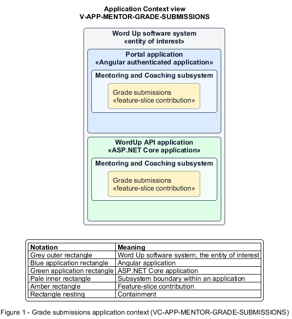

# Grade submissions

## Identification and scope

The Word Up software system is the entity of interest (EoI). The Grade submissions feature slice (`FS-MENTOR-GRADE-SUBMISSIONS`) is an architecture description element in the Mentoring and Coaching subsystem.

| Item | Identification |
| --- | --- |
| Participating applications | Portal application; WordUp API application |
| Architecture view | Application Context view (`V-APP-MENTOR-GRADE-SUBMISSIONS`) |
| Governing viewpoint | Application Context viewpoint (`VP-APP-CONTEXT`) |
| View component | Nested Application Context component (`VC-APP-MENTOR-GRADE-SUBMISSIONS`) |

This focused description addresses feature scope, behavior, application context, and requirement correspondences. It does not claim conformance as a complete architecture description.

## Overview

The Grade submissions feature slice allows an assigned mentor score work, save a private draft, approve it, or request revision.

## Application context

The Application Context view (`V-APP-MENTOR-GRADE-SUBMISSIONS`) applies the Application Context viewpoint (`VP-APP-CONTEXT`) to the Word Up software system. The viewpoint frames the application-location concern (`C-APP-LOCATION`). The view component (`VC-APP-MENTOR-GRADE-SUBMISSIONS`) uses the nested-containment model kind.

Nested rectangles identify the EoI, each participating application, the subsystem boundary, and the feature-slice contribution. Figure 1 presents the view component.

*Figure 1 — Application Context view: the Grade submissions feature slice within the participating Word Up applications.*

## Behavior

- **Entry.** A mentor opens a pending submission from their scoped review queue.
- **Processing.** The form constrains each rubric score and computes the total. A draft leaves youth status unchanged. Approval applies points and a badge. A revision request requires a note and supports guardian notification. The service authorizes and audits each action.
- **Result.** The submission reaches the selected review state and the youth receives an actionable update.

## Scope boundary

The Submit Assignments and Track and Revise Submissions feature slices own youth submission and resubmission presentation.

## Correspondences

The requirement-trace correspondence method (`M-REQ-TRACE`) relates stable L2 requirement identifiers to feature slices. The Grade submissions requirement correspondence (`COR-REQ-MENTOR-GRADE-SUBMISSIONS`) records the following relationships.

| Requirement | Relationship |
| --- | --- |
| `L2-MENTOR-003` | Primary requirement |
| `L2-LEARN-007` | Dependency |
| `L2-CONSENT-003` | Dependency |
| `L2-NFR-005` | Dependency |
