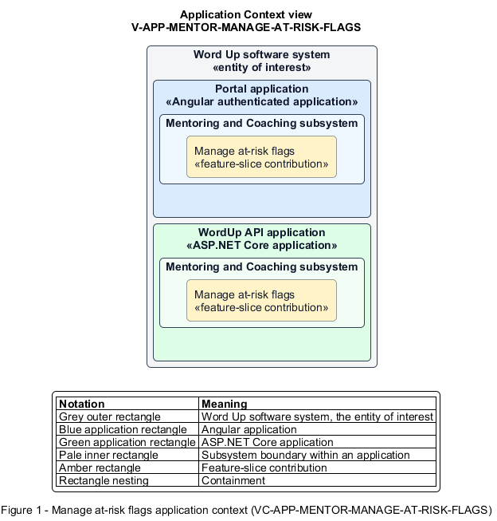

# Manage at-risk flags

## Identification and scope

The Word Up software system is the entity of interest (EoI). The Manage at-risk flags feature slice (`FS-MENTOR-MANAGE-AT-RISK-FLAGS`) is an architecture description element in the Mentoring and Coaching subsystem.

| Item | Identification |
| --- | --- |
| Participating applications | Portal application; WordUp API application |
| Architecture view | Application Context view (`V-APP-MENTOR-MANAGE-AT-RISK-FLAGS`) |
| Governing viewpoint | Application Context viewpoint (`VP-APP-CONTEXT`) |
| View component | Nested Application Context component (`VC-APP-MENTOR-MANAGE-AT-RISK-FLAGS`) |

This focused description addresses feature scope, behavior, application context, and requirement correspondences. It does not claim conformance as a complete architecture description.

## Overview

The Manage at-risk flags feature slice surfaces configured risk signals and lets a mentor act on or resolve them accountably.

## Application context

The Application Context view (`V-APP-MENTOR-MANAGE-AT-RISK-FLAGS`) applies the Application Context viewpoint (`VP-APP-CONTEXT`) to the Word Up software system. The viewpoint frames the application-location concern (`C-APP-LOCATION`). The view component (`VC-APP-MENTOR-MANAGE-AT-RISK-FLAGS`) uses the nested-containment model kind.

Nested rectangles identify the EoI, each participating application, the subsystem boundary, and the feature-slice contribution. Figure 1 presents the view component.

*Figure 1 — Application Context view: the Manage at-risk flags feature slice within the participating Word Up applications.*

## Behavior

- **Entry.** Activity crosses an inactivity, missed-session, or below-cohort-progress threshold, or a mentor opens an existing flag.
- **Processing.** The system records specific reasons and exposes message, check-in, and unflag actions; resolution requires a defined reason, remains director-visible, is audited, and permits a later re-flag when signals recur.
- **Result.** The active at-risk list represents unresolved current concerns and their causes.

## Scope boundary

Sending a message and logging a check-in use their own feature slices.

## Correspondences

The requirement-trace correspondence method (`M-REQ-TRACE`) relates stable L2 requirement identifiers to feature slices. The Manage at-risk flags requirement correspondence (`COR-REQ-MENTOR-MANAGE-AT-RISK-FLAGS`) records the following relationships.

| Requirement | Relationship |
| --- | --- |
| `L2-MENTOR-007` | Primary requirement |
| `L2-CONSENT-003` | Dependency |
| `L2-ENGAGE-007` | Dependency |
| `L2-MENTOR-006` | Dependency |
