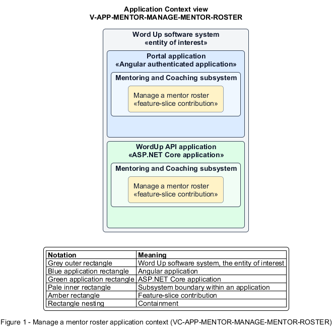

# Manage a mentor roster

## Identification and scope

The Word Up software system is the entity of interest (EoI). The Manage a mentor roster feature slice (`FS-MENTOR-MANAGE-MENTOR-ROSTER`) is an architecture description element in the Mentoring and Coaching subsystem.

| Item | Identification |
| --- | --- |
| Participating applications | Portal application; WordUp API application |
| Architecture view | Application Context view (`V-APP-MENTOR-MANAGE-MENTOR-ROSTER`) |
| Governing viewpoint | Application Context viewpoint (`VP-APP-CONTEXT`) |
| View component | Nested Application Context component (`VC-APP-MENTOR-MANAGE-MENTOR-ROSTER`) |

This focused description addresses feature scope, behavior, application context, and requirement correspondences. It does not claim conformance as a complete architecture description.

## Overview

The Manage a mentor roster feature slice provides a mentor a scoped operational view of assigned youth and pending coaching work.

## Application context

The Application Context view (`V-APP-MENTOR-MANAGE-MENTOR-ROSTER`) applies the Application Context viewpoint (`VP-APP-CONTEXT`) to the Word Up software system. The viewpoint frames the application-location concern (`C-APP-LOCATION`). The view component (`VC-APP-MENTOR-MANAGE-MENTOR-ROSTER`) uses the nested-containment model kind.

Nested rectangles identify the EoI, each participating application, the subsystem boundary, and the feature-slice contribution. Figure 1 presents the view component.

*Figure 1 — Application Context view: the Manage a mentor roster feature slice within the participating Word Up applications.*

## Behavior

- **Entry.** A mentor opens their dashboard or roster and optionally searches or filters by on-track, at-risk, or new.
- **Processing.** The server computes youth, progress, risk, and review counts only from assigned relationships; the UI shows overdue review links, filters, and labelled empty states.
- **Result.** The mentor can choose the next youth or review that needs attention.

## Scope boundary

Opening a youth record and completing a review are separate slices.

## Correspondences

The requirement-trace correspondence method (`M-REQ-TRACE`) relates stable L2 requirement identifiers to feature slices. The Manage a mentor roster requirement correspondence (`COR-REQ-MENTOR-MANAGE-MENTOR-ROSTER`) records the following relationships.

| Requirement | Relationship |
| --- | --- |
| `L2-MENTOR-001` | Primary requirement |
| `L2-AUTH-010` | Dependency |
