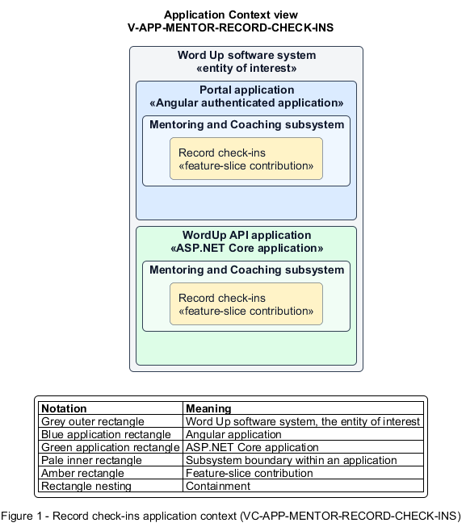

# Record check-ins

## Identification and scope

The Word Up software system is the entity of interest (EoI). The Record check-ins feature slice (`FS-MENTOR-RECORD-CHECK-INS`) is an architecture description element in the Mentoring and Coaching subsystem.

| Item | Identification |
| --- | --- |
| Participating applications | Portal application; WordUp API application |
| Architecture view | Application Context view (`V-APP-MENTOR-RECORD-CHECK-INS`) |
| Governing viewpoint | Application Context viewpoint (`VP-APP-CONTEXT`) |
| View component | Nested Application Context component (`VC-APP-MENTOR-RECORD-CHECK-INS`) |

This focused description addresses feature scope, behavior, application context, and requirement correspondences. It does not claim conformance as a complete architecture description.

## Overview

The Record check-ins feature slice allows mentors document coaching conversations with deliberate privacy and follow-up controls.

## Application context

The Application Context view (`V-APP-MENTOR-RECORD-CHECK-INS`) applies the Application Context viewpoint (`VP-APP-CONTEXT`) to the Word Up software system. The viewpoint frames the application-location concern (`C-APP-LOCATION`). The view component (`VC-APP-MENTOR-RECORD-CHECK-INS`) uses the nested-containment model kind.

Nested rectangles identify the EoI, each participating application, the subsystem boundary, and the feature-slice contribution. Figure 1 presents the view component.

*Figure 1 — Application Context view: the Record check-ins feature slice within the participating Word Up applications.*

## Behavior

- **Entry.** A mentor starts a check-in for an assigned youth or opens the scoped check-in history.
- **Processing.** The form captures required youth, date, and type plus mood, goals, prayer, actions, guardian-informed state, and follow-up; sharing defaults private and prayer remains private unless explicitly shared.
- **Result.** The check-in is retained for safeguarding, appears in filtered history, and exposes only authorized shared content.

## Scope boundary

General messaging and at-risk flag resolution are separate coaching actions.

## Correspondences

The requirement-trace correspondence method (`M-REQ-TRACE`) relates stable L2 requirement identifiers to feature slices. The Record check-ins requirement correspondence (`COR-REQ-MENTOR-RECORD-CHECK-INS`) records the following relationships.

| Requirement | Relationship |
| --- | --- |
| `L2-MENTOR-006` | Primary requirement |
| `L2-AUTH-010` | Dependency |
| `L2-CONSENT-003` | Dependency |
| `L2-CONSENT-004` | Dependency |
