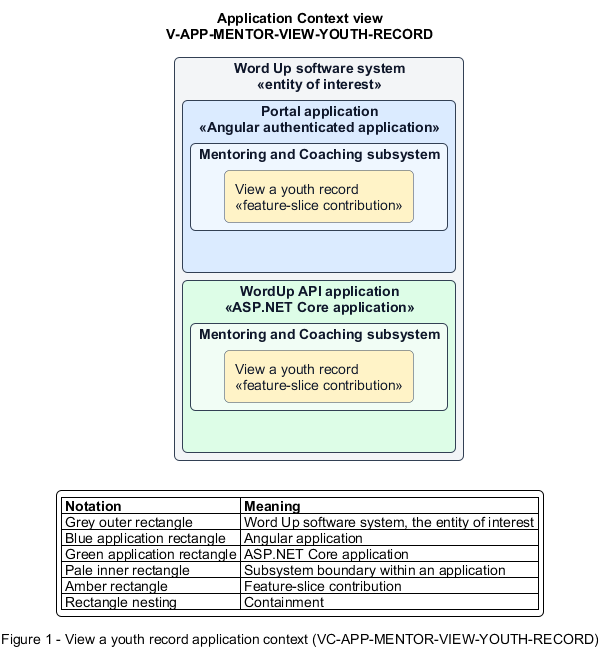

# View a youth record

## Identification and scope

The Word Up software system is the entity of interest (EoI). The View a youth record feature slice (`FS-MENTOR-VIEW-YOUTH-RECORD`) is an architecture description element in the Mentoring and Coaching subsystem.

| Item | Identification |
| --- | --- |
| Participating applications | Portal application; WordUp API application |
| Architecture view | Application Context view (`V-APP-MENTOR-VIEW-YOUTH-RECORD`) |
| Governing viewpoint | Application Context viewpoint (`VP-APP-CONTEXT`) |
| View component | Nested Application Context component (`VC-APP-MENTOR-VIEW-YOUTH-RECORD`) |

This focused description addresses feature scope, behavior, application context, and requirement correspondences. It does not claim conformance as a complete architecture description.

## Overview

The View a youth record feature slice provides an assigned mentor the complete, safeguarded context needed to coach one youth.

## Application context

The Application Context view (`V-APP-MENTOR-VIEW-YOUTH-RECORD`) applies the Application Context viewpoint (`VP-APP-CONTEXT`) to the Word Up software system. The viewpoint frames the application-location concern (`C-APP-LOCATION`). The view component (`VC-APP-MENTOR-VIEW-YOUTH-RECORD`) uses the nested-containment model kind.

Nested rectangles identify the EoI, each participating application, the subsystem boundary, and the feature-slice contribution. Figure 1 presents the view component.

*Figure 1 — Application Context view: the View a youth record feature slice within the participating Word Up applications.*

## Behavior

- **Entry.** A mentor selects a youth from their authorized roster.
- **Processing.** The server verifies the assignment and returns profile, staff-visible guardian contact, progress, attendance, check-ins, submissions, competencies, and any at-risk banner in tabbed read models.
- **Result.** The mentor can understand the youth's current situation and continue to an appropriate coaching action.

## Scope boundary

Editing domain records occurs through dedicated grading, assessment, check-in, risk, and assignment slices.

## Correspondences

The requirement-trace correspondence method (`M-REQ-TRACE`) relates stable L2 requirement identifiers to feature slices. The View a youth record requirement correspondence (`COR-REQ-MENTOR-VIEW-YOUTH-RECORD`) records the following relationships.

| Requirement | Relationship |
| --- | --- |
| `L2-MENTOR-002` | Primary requirement |
| `L2-AUTH-009` | Dependency |
| `L2-CONSENT-004` | Dependency |
