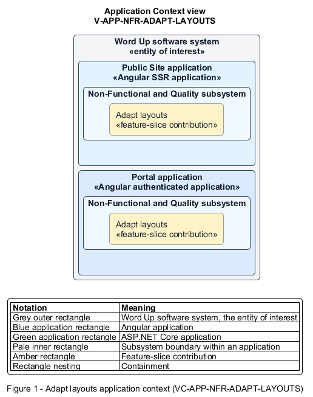

# Adapt layouts

## Identification and scope

The Word Up software system is the entity of interest (EoI). The Adapt layouts feature slice (`FS-NFR-ADAPT-LAYOUTS`) is an architecture description element in the Non-Functional and Quality subsystem.

| Item | Identification |
| --- | --- |
| Participating applications | Public Site application; Portal application |
| Architecture view | Application Context view (`V-APP-NFR-ADAPT-LAYOUTS`) |
| Governing viewpoint | Application Context viewpoint (`VP-APP-CONTEXT`) |
| View component | Nested Application Context component (`VC-APP-NFR-ADAPT-LAYOUTS`) |

This focused description addresses feature scope, behavior, application context, and requirement correspondences. It does not claim conformance as a complete architecture description.

## Overview

The Adapt layouts feature slice keeps every user journey usable from extra-small phones through extra-large staff displays.

## Application context

The Application Context view (`V-APP-NFR-ADAPT-LAYOUTS`) applies the Application Context viewpoint (`VP-APP-CONTEXT`) to the Word Up software system. The viewpoint frames the application-location concern (`C-APP-LOCATION`). The view component (`VC-APP-NFR-ADAPT-LAYOUTS`) uses the nested-containment model kind.

Nested rectangles identify the EoI, each participating application, the subsystem boundary, and the feature-slice contribution. Figure 1 presents the view component.

*Figure 1 — Application Context view: the Adapt layouts feature slice within the participating Word Up applications.*

## Behavior

- **Entry.** Any application page renders at a supported viewport breakpoint.
- **Processing.** Layouts use mobile-first single columns, wide widgets scroll inside bounded containers, staff dashboards add columns at larger widths, and XS data tables reflow to labelled cards without page overflow.
- **Result.** The same feature remains understandable and operable at every supported size.

## Scope boundary

Feature slices own their content hierarchy; this contract defines shared responsive behavior.

## Correspondences

The requirement-trace correspondence method (`M-REQ-TRACE`) relates stable L2 requirement identifiers to feature slices. The Adapt layouts requirement correspondence (`COR-REQ-NFR-ADAPT-LAYOUTS`) records the following relationships.

| Requirement | Relationship |
| --- | --- |
| `L2-NFR-009` | Primary requirement |
