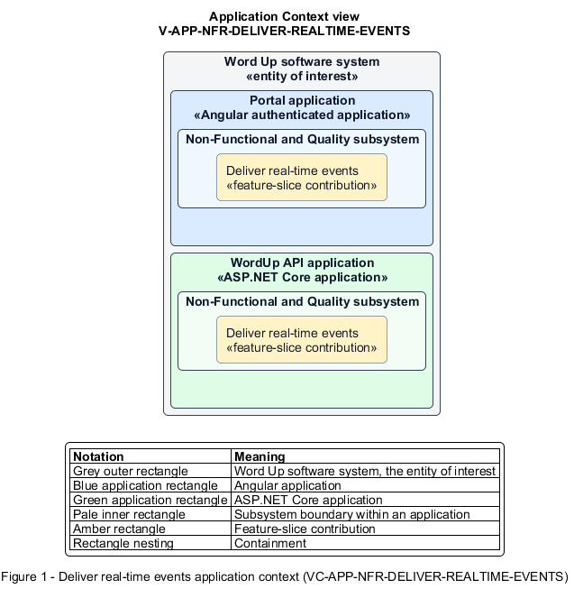

# Deliver real-time events

## Identification and scope

The Word Up software system is the entity of interest (EoI). The Deliver real-time events feature slice (`FS-NFR-DELIVER-REALTIME-EVENTS`) is an architecture description element in the Non-Functional and Quality subsystem.

| Item | Identification |
| --- | --- |
| Participating applications | Portal application; WordUp API application |
| Architecture view | Application Context view (`V-APP-NFR-DELIVER-REALTIME-EVENTS`) |
| Governing viewpoint | Application Context viewpoint (`VP-APP-CONTEXT`) |
| View component | Nested Application Context component (`VC-APP-NFR-DELIVER-REALTIME-EVENTS`) |

This focused description addresses feature scope, behavior, application context, and requirement correspondences. It does not claim conformance as a complete architecture description.

## Overview

The Deliver real-time events feature slice securely transports notifications and messages to currently connected authorized recipients.

## Application context

The Application Context view (`V-APP-NFR-DELIVER-REALTIME-EVENTS`) applies the Application Context viewpoint (`VP-APP-CONTEXT`) to the Word Up software system. The viewpoint frames the application-location concern (`C-APP-LOCATION`). The view component (`VC-APP-NFR-DELIVER-REALTIME-EVENTS`) uses the nested-containment model kind.

Nested rectangles identify the EoI, each participating application, the subsystem boundary, and the feature-slice contribution. Figure 1 presents the view component.

*Figure 1 — Application Context view: the Deliver real-time events feature slice within the participating Word Up applications.*

## Behavior

- **Entry.** An in-scope notification or message is committed and identifies recipients.
- **Processing.** Authenticated connections join only permitted user, cohort, and role groups; payloads contain scoped data, reconnecting clients reconcile canonical state, and duplicate handling is avoided.
- **Result.** Connected recipients see timely updates while disconnected clients recover the same state on reload.

## Scope boundary

Domain event creation, notification preferences, and read-state persistence remain functional slices.

## Correspondences

The requirement-trace correspondence method (`M-REQ-TRACE`) relates stable L2 requirement identifiers to feature slices. The Deliver real-time events requirement correspondence (`COR-REQ-NFR-DELIVER-REALTIME-EVENTS`) records the following relationships.

| Requirement | Relationship |
| --- | --- |
| `L2-NFR-005` | Primary requirement |
| `L2-AUTH-010` | Dependency |
| `L2-ENGAGE-007` | Dependency |
| `L2-ENGAGE-008` | Dependency |
