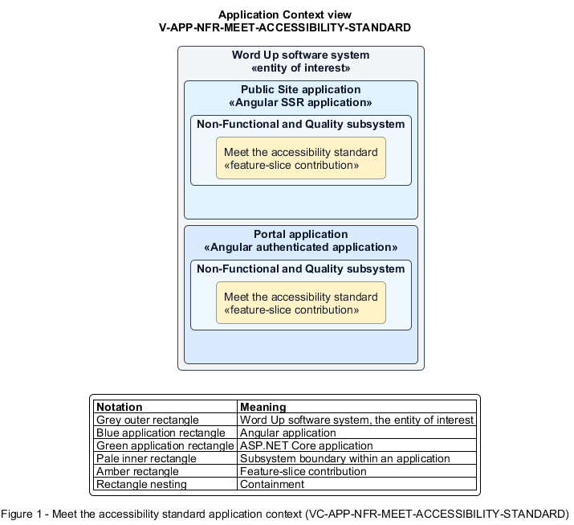

# Meet the accessibility standard

## Identification and scope

The Word Up software system is the entity of interest (EoI). The Meet the accessibility standard feature slice (`FS-NFR-MEET-ACCESSIBILITY-STANDARD`) is an architecture description element in the Non-Functional and Quality subsystem.

| Item | Identification |
| --- | --- |
| Participating applications | Public Site application; Portal application |
| Architecture view | Application Context view (`V-APP-NFR-MEET-ACCESSIBILITY-STANDARD`) |
| Governing viewpoint | Application Context viewpoint (`VP-APP-CONTEXT`) |
| View component | Nested Application Context component (`VC-APP-NFR-MEET-ACCESSIBILITY-STANDARD`) |

This focused description addresses feature scope, behavior, application context, and requirement correspondences. It does not claim conformance as a complete architecture description.

## Overview

The Meet the accessibility standard feature slice makes each user journey operable and perceivable to WCAG 2.1 AA.

## Application context

The Application Context view (`V-APP-NFR-MEET-ACCESSIBILITY-STANDARD`) applies the Application Context viewpoint (`VP-APP-CONTEXT`) to the Word Up software system. The viewpoint frames the application-location concern (`C-APP-LOCATION`). The view component (`VC-APP-NFR-MEET-ACCESSIBILITY-STANDARD`) uses the nested-containment model kind.

Nested rectangles identify the EoI, each participating application, the subsystem boundary, and the feature-slice contribution. Figure 1 presents the view component.

*Figure 1 — Application Context view: the Meet the accessibility standard feature slice within the participating Word Up applications.*

## Behavior

- **Entry.** A user navigates any interface with touch, keyboard, assistive technology, or accessibility preferences.
- **Processing.** Controls meet target size and naming rules, inputs have labels, state is not color-only, focus is visible and ordered, dialogs manage focus and Escape, and contrast meets AA.
- **Result.** Core functionality is available without reliance on a particular pointer, vision mode, or color perception.

## Scope boundary

Display preferences may exceed the baseline but cannot weaken it.

## Correspondences

The requirement-trace correspondence method (`M-REQ-TRACE`) relates stable L2 requirement identifiers to feature slices. The Meet the accessibility standard requirement correspondence (`COR-REQ-NFR-MEET-ACCESSIBILITY-STANDARD`) records the following relationships.

| Requirement | Relationship |
| --- | --- |
| `L2-NFR-010` | Primary requirement |
| `L2-PLATFORM-004` | Dependency |
