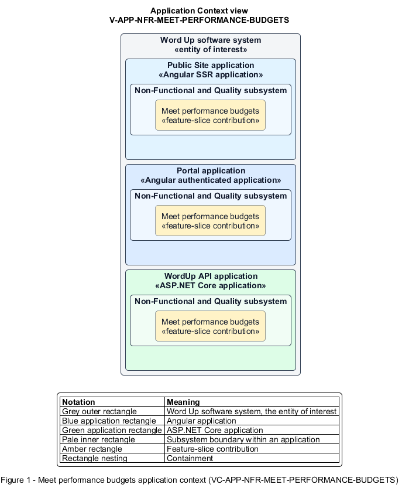

# Meet performance budgets

## Identification and scope

The Word Up software system is the entity of interest (EoI). The Meet performance budgets feature slice (`FS-NFR-MEET-PERFORMANCE-BUDGETS`) is an architecture description element in the Non-Functional and Quality subsystem.

| Item | Identification |
| --- | --- |
| Participating applications | Public Site application; Portal application; WordUp API application |
| Architecture view | Application Context view (`V-APP-NFR-MEET-PERFORMANCE-BUDGETS`) |
| Governing viewpoint | Application Context viewpoint (`VP-APP-CONTEXT`) |
| View component | Nested Application Context component (`VC-APP-NFR-MEET-PERFORMANCE-BUDGETS`) |

This focused description addresses feature scope, behavior, application context, and requirement correspondences. It does not claim conformance as a complete architecture description.

## Overview

The Meet performance budgets feature slice makes response time, payload size, interaction readiness, and sustained throughput measurable product behavior.

## Application context

The Application Context view (`V-APP-NFR-MEET-PERFORMANCE-BUDGETS`) applies the Application Context viewpoint (`VP-APP-CONTEXT`) to the Word Up software system. The viewpoint frames the application-location concern (`C-APP-LOCATION`). The view component (`VC-APP-NFR-MEET-PERFORMANCE-BUDGETS`) uses the nested-containment model kind.

Nested rectangles identify the EoI, each participating application, the subsystem boundary, and the feature-slice contribution. Figure 1 presents the view component.

*Figure 1 — Application Context view: the Meet performance budgets feature slice within the participating Word Up applications.*

## Behavior

- **Entry.** Representative reads, large views, youth screens, and concurrent workloads run under defined test conditions.
- **Processing.** APIs target a 300 ms median and 800 ms p95, excluding network time. Lists use bounded paging or aggregation. Chromebook-class youth screens target interaction within 3 s. Load tests measure the error rate.
- **Result.** Primary journeys remain responsive as organization and concurrent-user volume grow.

## Scope boundary

Feature-specific queries still own their data semantics; this slice supplies budgets and verification.

## Correspondences

The requirement-trace correspondence method (`M-REQ-TRACE`) relates stable L2 requirement identifiers to feature slices. The Meet performance budgets requirement correspondence (`COR-REQ-NFR-MEET-PERFORMANCE-BUDGETS`) records the following relationships.

| Requirement | Relationship |
| --- | --- |
| `L2-NFR-008` | Primary requirement |
