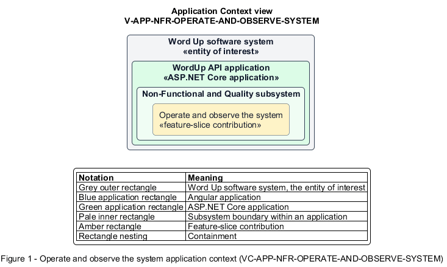

# Operate and observe the system

## Identification and scope

The Word Up software system is the entity of interest (EoI). The Operate and observe the system feature slice (`FS-NFR-OPERATE-AND-OBSERVE-SYSTEM`) is an architecture description element in the Non-Functional and Quality subsystem.

| Item | Identification |
| --- | --- |
| Participating applications | WordUp API application |
| Architecture view | Application Context view (`V-APP-NFR-OPERATE-AND-OBSERVE-SYSTEM`) |
| Governing viewpoint | Application Context viewpoint (`VP-APP-CONTEXT`) |
| View component | Nested Application Context component (`VC-APP-NFR-OPERATE-AND-OBSERVE-SYSTEM`) |

This focused description addresses feature scope, behavior, application context, and requirement correspondences. It does not claim conformance as a complete architecture description.

## Overview

The Operate and observe the system feature slice allows operators detect health, trace failures, and run controlled administration using the same application rules.

## Application context

The Application Context view (`V-APP-NFR-OPERATE-AND-OBSERVE-SYSTEM`) applies the Application Context viewpoint (`VP-APP-CONTEXT`) to the Word Up software system. The viewpoint frames the application-location concern (`C-APP-LOCATION`). The view component (`VC-APP-NFR-OPERATE-AND-OBSERVE-SYSTEM`) uses the nested-containment model kind.

Nested rectangles identify the EoI, each participating application, the subsystem boundary, and the feature-slice contribution. Figure 1 presents the view component.

*Figure 1 — Application Context view: the Operate and observe the system feature slice within the participating Word Up applications.*

## Behavior

- **Entry.** A probe, request, deployment, or out-of-band CLI command reaches the platform.
- **Processing.** Liveness and readiness report process and database health, structured logs carry correlation IDs with redaction, startup validates configuration and migrations, and CLI operations reuse validated application logic.
- **Result.** Deployments fail safely, incidents are diagnosable, and operational tasks do not bypass domain controls.

## Scope boundary

The admin CLI is operational tooling, not a user-facing product surface.

## Correspondences

The requirement-trace correspondence method (`M-REQ-TRACE`) relates stable L2 requirement identifiers to feature slices. The Operate and observe the system requirement correspondence (`COR-REQ-NFR-OPERATE-AND-OBSERVE-SYSTEM`) records the following relationships.

| Requirement | Relationship |
| --- | --- |
| `L2-NFR-011` | Primary requirement |
