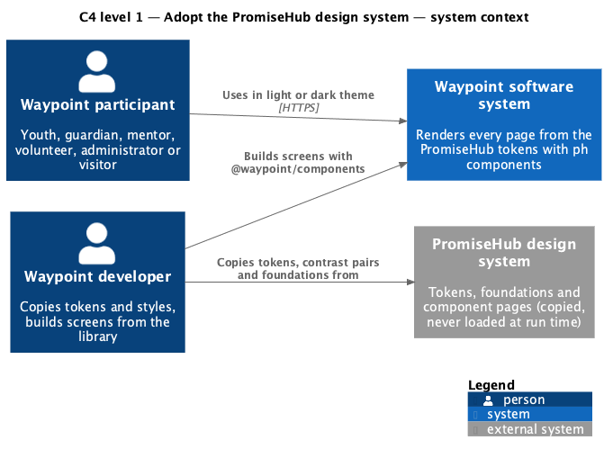
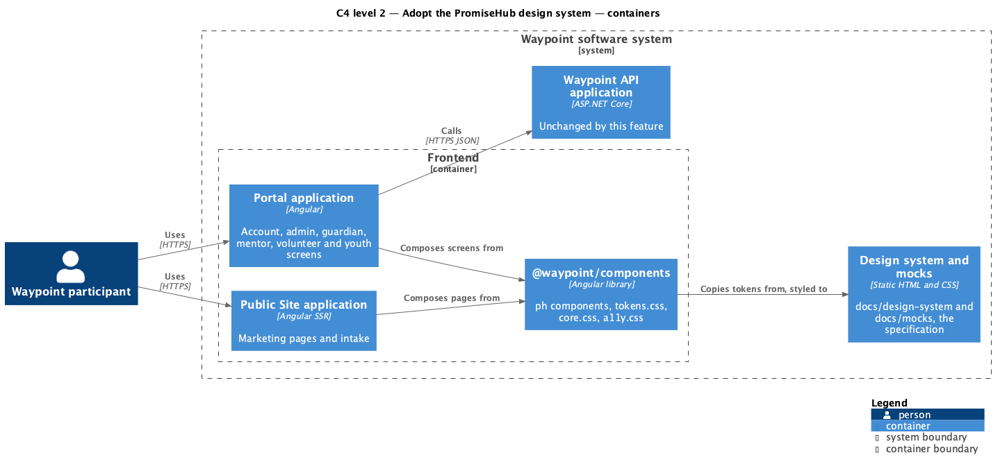
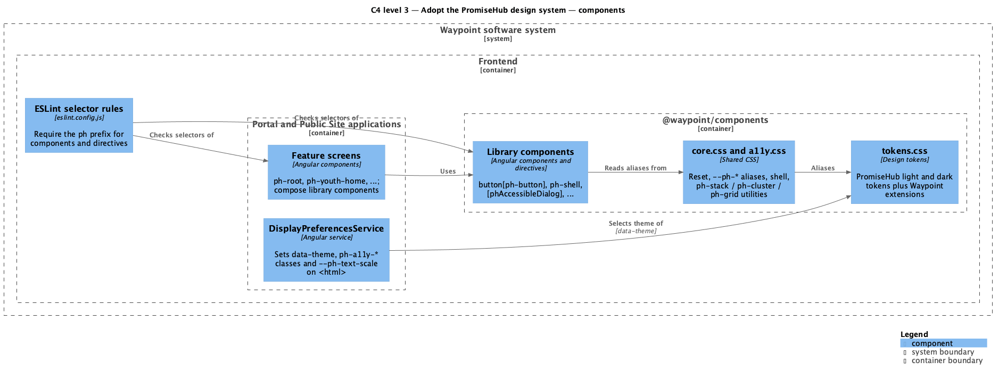
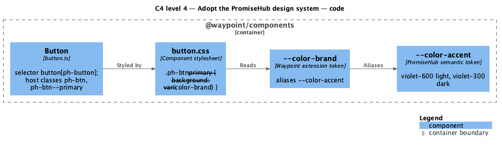
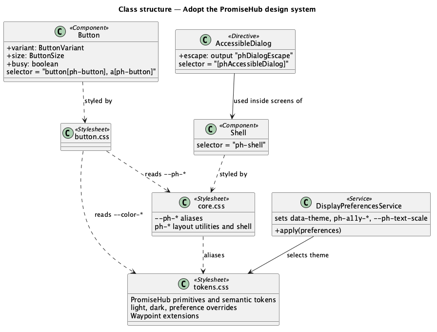
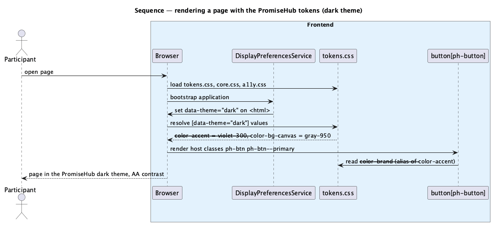

# Adopt the PromiseHub design system

## Overview

Waypoint is a youth-leadership software system for program intake, learning, mentoring, safeguarding, and program operations. The Non-Functional and Quality subsystem owns this feature slice.

The Adopt the PromiseHub design system feature slice refines `L2-NFR-012` into one cross-cutting change. Every application shall render from the PromiseHub design system in the light and the dark theme, and every `@waypoint/components` component shall use the `ph` prefix. Screens, routes, copy, data and behaviour do not change.

A *design token* is a named CSS custom property, such as `--color-bg-canvas`, that a component reads instead of a literal value. The *PromiseHub design system* is the token set, foundations and component pages in `promise-hub/docs/design-system/`. They are copied into this repository; nothing reads the promise-hub folder at build or run time. The *prefix* is the leading segment of a component's selector, class names and custom properties: `w` before this change, `ph` after it.

The Waypoint software system is the entity of interest (EoI). This focused architecture description (AD) addresses the feature boundary, participating applications, software structure, requirements, and behavior. It does not claim conformance as a complete AD; stakeholder perspectives, complete concern coverage, correspondences outside requirement traceability, and architecture decisions remain in the system-level AD and in DECISIONS #25.

## Description

### Vertical slice boundary

The feature spans every frontend application (Portal shell with the account, admin, guardian, mentor, volunteer and youth feature libraries; Public Site) and the shared `@waypoint/components` library. It changes stylesheets, selectors and class names only. The Waypoint API application is not changed: no endpoint, contract, rule or persisted value changes. The [Switch theme](../../platform-services/switch-theme/README.md) slice keeps owning how the light or dark theme is chosen and applied; this slice changes the values the themes resolve to.

### Components and types

| Layer | Components, types, and classes | Responsibility |
| --- | --- | --- |
| Design tokens | [`tokens.css`](../../../../frontend/projects/components/src/styles/tokens.css) (copy of [`docs/design-system/tokens/tokens.css`](../../../design-system/tokens/tokens.css)) | Holds the PromiseHub primitives, semantic tokens, light and dark themes and preference overrides, plus the *Waypoint extensions* block. |
| Shared CSS | [`core.css`](../../../../frontend/projects/components/src/styles/core.css), [`a11y.css`](../../../../frontend/projects/components/src/styles/a11y.css) | Resets, base type, the `--ph-*` component aliases over the semantic tokens, the shell and the layout utilities (`ph-stack`, `ph-cluster`, `ph-grid`, ...), and the display-preference hooks. |
| Library components | [`Button`](../../../../frontend/projects/components/src/lib/button/button.ts), [`Alert`](../../../../frontend/projects/components/src/lib/alert/alert.ts), [`Card`](../../../../frontend/projects/components/src/lib/card/card.ts), [`Dialog`](../../../../frontend/projects/components/src/lib/dialog/dialog.ts), [`AccessibleDialog`](../../../../frontend/projects/components/src/lib/dialog/accessible-dialog.ts) and the other components of `@waypoint/components` | Own their `ph-*` selector, host classes and stylesheet, restyled to the PromiseHub component pages. |
| Feature screens | Page components in `frontend/projects/{account,admin,guardian,mentor,volunteer,youth,portal,public-site}` | Compose screens from the library with `ph` selectors; selectors of app components (`ph-root`, `ph-youth-home`) take the same prefix. |
| Theme hook | [`DisplayPreferencesService`](../../../../frontend/projects/core/src/lib/display-preferences.service.ts) | Sets `data-theme` and the `ph-a11y-*` classes and `--ph-text-scale` on the document root (unchanged behaviour, renamed hooks). |
| Enforcement | [`eslint.config.js`](../../../../frontend/eslint.config.js), [`angular.json`](../../../../frontend/angular.json) | `@angular-eslint/component-selector` and `directive-selector` require the `ph` prefix; every project's `prefix` is `ph`. |
| Acceptance tests | [`theme.spec.ts`](../../../../frontend/e2e/portal/settings/theme.spec.ts), [`design-system.spec.ts`](../../../../frontend/e2e/portal/design-system.spec.ts), page objects in [`frontend/e2e/pages`](../../../../frontend/e2e/pages) | Prove the PromiseHub values, the `ph` hooks and AA contrast; page objects own every selector (DECISIONS #15). |

### Token mapping

PromiseHub and Waypoint share one semantic vocabulary (`--color-bg-canvas`, `--color-accent`, `--space-4`, `--radius-md`, ...), so components keep reading the same semantic names and receive PromiseHub values. The table lists the tokens whose meaning or value moves.

| Waypoint token (before) | PromiseHub token (after) | Note |
| --- | --- | --- |
| `--palette-ink-*` (warm greige to ink) | `--palette-gray-*` | Neutral ramp; every semantic surface, text and border token now resolves to gray. |
| `--palette-lime-*` | `--palette-violet-*` | Brand hue. |
| `--palette-tomato-*`, `--palette-teal-*` | `--palette-red-*`, `--palette-blue-*` | Danger and info hues. |
| `--color-brand`, `--color-brand-hover`, `--color-fg-on-brand` | `--color-accent`, `--color-accent-hover`, `--color-fg-on-accent` | Kept as aliases in the Waypoint extensions block; the primary action becomes violet with a white (light) or violet-950 (dark) label. |
| `--color-accent` (ink in light, lime in dark) | `--color-accent` (violet-600 light, violet-300 dark) | Selection, current state and focus ring follow the accent. |
| `--font-family-sans` (Inter), `--font-family-heading` (Space Grotesk) | `--font-family-sans`, `--font-family-display` (system rounded stack) | `--font-family-heading` aliases `--font-family-display`; the embedded webfonts are removed. |
| `--font-family-serif` (Fraunces), `--text-scripture` | Waypoint extension: Georgia | Scripture only; PromiseHub has no serif. |
| `--layout-botnav-height` (76px) | `--layout-tabbar-height` (64px) | Alias in the extensions block. |
| `--layout-container-wide`, `--layout-container-narrow`, `--border-width-accent`, `--color-fg-inverse-muted` | Waypoint extensions | No PromiseHub equivalent; values kept, `--color-fg-inverse-muted` re-based on gray. |
| `--w-*` component aliases in `core.css` (`--w-lime`, `--w-ink`, `--w-g100`, `--w-font-head`, `--w-r-pill`, `--w-s4`, ...) | `--ph-*` aliases over the same semantic tokens | Fonts, radii and decorative accents now alias PromiseHub tokens instead of literals. |

### Selector rename and layout utilities

Every `w-` identifier with a component meaning becomes `ph-`: element selectors (`<w-shell>` to `<ph-shell>`), attribute selectors (`button[w-button]` to `button[ph-button]`), camel-case directive selectors (`[wuAccessibleDialog]` to `[phAccessibleDialog]`, `wuDialogInitialFocus` to `phDialogInitialFocus`), host and part classes (`.w-btn--primary` to `.ph-btn--primary`), state hooks (`ph-a11y-contrast`), keyframes and `--w-*` custom properties. Class and file names stay unprefixed (`Button` in `button.ts`). Storage keys (`w.attendance.queue.*`, `w.transient-form-draft`) are data, not component syntax, and are not renamed, so saved drafts and queued attendance survive the upgrade.

The shared layout, spacing and typography utilities (`w-stack`, `w-cluster`, `w-grid`, `w-container`, `w-page*`, `w-mb-*`, `w-mt-*`, `w-muted`, `w-eyebrow`, `w-text-*`) become `ph-*` with unchanged behaviour. PromiseHub's own unprefixed utilities (`.stack`, `.cluster`, `.grid`, `.container`) are not adopted: they would collide with app class names and leave two vocabularies in one codebase.

PromiseHub's component class vocabulary (`.btn`, `.field__label`, `.dialog__panel`) is not adopted either. The library keeps its own class structure under the `ph` prefix and restyles it to the PromiseHub component pages, so no screen's markup or DOM structure changes.

### Migration order

1. Mocks and the design system (documentation): tokens, foundations, `ph-*` markup.
2. Tokens: `tokens.css` replaced; `core.css` aliases and fonts re-pointed at PromiseHub tokens; webfonts removed.
3. Prefix switch: `prefix` in `angular.json`, ESLint selector rules, then every library and app selector, class, hook and page-object selector renamed in one slice so the build never mixes prefixes.
4. Restyle: component stylesheets moved to PromiseHub metrics (hairline-edged pill buttons, label type, elevated cards, left-ruled alerts, accent tints for the `lime` variants).
5. Storybook stories and library docs renamed.

### Functions and data flow

- The browser loads `tokens.css`, `core.css` and `a11y.css` through each application's `styles` entry in `angular.json`.
- `DisplayPreferencesService` writes `data-theme` on `<html>` (or leaves it unset for System); the token file resolves every semantic token for that theme.
- Each library component sets its `ph-*` host classes; its stylesheet reads `--ph-*` aliases and semantic tokens only.

### Behavior

1. **Entry.** A participant opens any page of any Waypoint application.
2. **Processing.** The page loads the PromiseHub tokens. The theme hook selects the light or dark token values. Library components render with `ph` selectors and classes and read the tokens.
3. **Result.** The page renders in the PromiseHub look with AA contrast; its flows behave as before.

### Risks

| Risk | Mitigation |
| --- | --- |
| A missed `w-` reference leaves an unstyled element or a broken selector. | The rename is one scripted pass over the library, apps, page objects and docs; ESLint rejects `w` selectors; the full Playwright suite runs against the real API. |
| A test reads computed colours or text that change with the theme. | Theme specs are updated first, as the failing acceptance test of the token slice. |
| Dropping the webfonts changes text metrics and wraps layouts differently. | Responsive specs at XS to XL check for horizontal overflow on every role's screens. |
| The violet accent fails contrast in a pair Waypoint uses but PromiseHub does not. | Waypoint-only pairs are added to `contrast-pairs.json` and checked in both themes; the segmented-control track moved from `--color-bg-subtle-hover` to `--color-bg-subtle` to pass 4.5:1. |
| Existing saved drafts or queues are lost by a key rename. | Storage keys are excluded from the rename. |

### Open questions

- PromiseHub-only components (attendance dots, medical flag, call list, roster mapping, slip event, SMS preview, signature, plan meter, guardian shell) are deferred until a Waypoint screen needs them.
- The `lime` variant names (`variant="lime"`, `.ph-card--lime`) are kept to avoid an API change; they render with the violet accent tint. Renaming them is deferred.

## Requirements

This section contains L2 specification text and L1 trace identifiers. It contains no L1 specification text. Normative wording uses `shall` in accordance with the architecture-description voice.

### L2-NFR-012 — PromiseHub design system and the `ph` component prefix

| Field | Value |
| --- | --- |
| Relationship | Primary |
| L1 specification ID | `L1-NFR-007`, `L1-PLATFORM-002` |

Every application shall render from the PromiseHub design system in both the light and the dark theme, and every library component shall use the `ph` prefix. Screens, routes, copy, data and behaviour shall stay as specified by their own requirements.

### L2-PLATFORM-013 — Light and dark theme

| Field | Value |
| --- | --- |
| Relationship | Dependency |
| L1 specification ID | `L1-PLATFORM-002` |

Every page shall render from one set of design tokens, the PromiseHub tokens of L2-NFR-012, in a light theme and a dark theme.

### L2-NFR-010 — Accessibility (WCAG 2.2 AA)

| Field | Value |
| --- | --- |
| Relationship | Dependency |
| L1 specification ID | `L1-NFR-007` |

The UI shall be operable and perceivable per WCAG 2.2 AA.

## Diagrams

The six figures use one visual vocabulary. Blue boxes identify Waypoint elements, people and the Waypoint system; grey boxes identify the external PromiseHub source. Nested boxes identify the software boundary and the owning application or library.

### C4 diagrams

#### System context

Figure 1 is a view component governed by the C4 system-context model kind. It identifies the people who see the restyled pages and the PromiseHub design system the tokens are copied from.

*Figure 1 — C4 system context: Adopt the PromiseHub design system in the Waypoint environment.*

#### Container

Figure 2 is a view component governed by the C4 container model kind. It separates the frontend applications from the shared library and the documentation.

*Figure 2 — C4 container view: application and library boundaries for Adopt the PromiseHub design system.*

#### Component

Figure 3 is a view component governed by the C4 component model kind. It locates the tokens, shared CSS, library components, theme hook and lint rules.

*Figure 3 — C4 component view: collaborating components for Adopt the PromiseHub design system.*

#### Code

Figure 4 is a view component governed by the C4 code model kind. It shows how a component reaches a PromiseHub value.

*Figure 4 — C4 code view: from a ph selector to a PromiseHub token for Adopt the PromiseHub design system.*

### Class diagram

Figure 5 is a view component governed by the UML class-structure model kind. Solid relationships show runtime collaboration and dashed relationships show stylesheet dependency.

*Figure 5 — Class structure: relationships among components, stylesheets and tokens for Adopt the PromiseHub design system.*

### Sequence diagram

Figure 6 is a view component governed by the UML sequence model kind. It follows one page render in the dark theme.

*Figure 6 — Sequence behavior: rendering a page with the PromiseHub tokens.*
