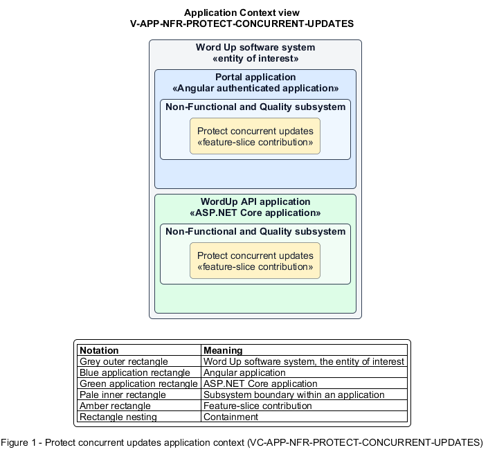

# Protect concurrent updates

## Identification and scope

The Word Up software system is the entity of interest (EoI). The Protect concurrent updates feature slice (`FS-NFR-PROTECT-CONCURRENT-UPDATES`) is an architecture description element in the Non-Functional and Quality subsystem.

| Item | Identification |
| --- | --- |
| Participating applications | Portal application; WordUp API application |
| Architecture view | Application Context view (`V-APP-NFR-PROTECT-CONCURRENT-UPDATES`) |
| Governing viewpoint | Application Context viewpoint (`VP-APP-CONTEXT`) |
| View component | Nested Application Context component (`VC-APP-NFR-PROTECT-CONCURRENT-UPDATES`) |

This focused description addresses feature scope, behavior, application context, and requirement correspondences. It does not claim conformance as a complete architecture description.

## Overview

The Protect concurrent updates feature slice prevents silent overwrites and partial commits on mutable program records.

## Application context

The Application Context view (`V-APP-NFR-PROTECT-CONCURRENT-UPDATES`) applies the Application Context viewpoint (`VP-APP-CONTEXT`) to the Word Up software system. The viewpoint frames the application-location concern (`C-APP-LOCATION`). The view component (`VC-APP-NFR-PROTECT-CONCURRENT-UPDATES`) uses the nested-containment model kind.

Nested rectangles identify the EoI, each participating application, the subsystem boundary, and the feature-slice contribution. Figure 1 presents the view component.

*Figure 1 — Application Context view: the Protect concurrent updates feature slice within the participating Word Up applications.*

## Behavior

- **Entry.** A command updates a versioned aggregate or starts a critical multi-record operation.
- **Processing.** The server compares version tokens, rejects stale writes with reconcilable conflict details, advances versions after success, and wraps critical workflows such as approval plus enrollment in a transaction.
- **Result.** Users either commit one consistent result or receive an explicit conflict; partial domain state is never accepted.

## Scope boundary

Each functional slice chooses its user-facing reconciliation experience.

## Correspondences

The requirement-trace correspondence method (`M-REQ-TRACE`) relates stable L2 requirement identifiers to feature slices. The Protect concurrent updates requirement correspondence (`COR-REQ-NFR-PROTECT-CONCURRENT-UPDATES`) records the following relationships.

| Requirement | Relationship |
| --- | --- |
| `L2-NFR-006` | Primary requirement |
