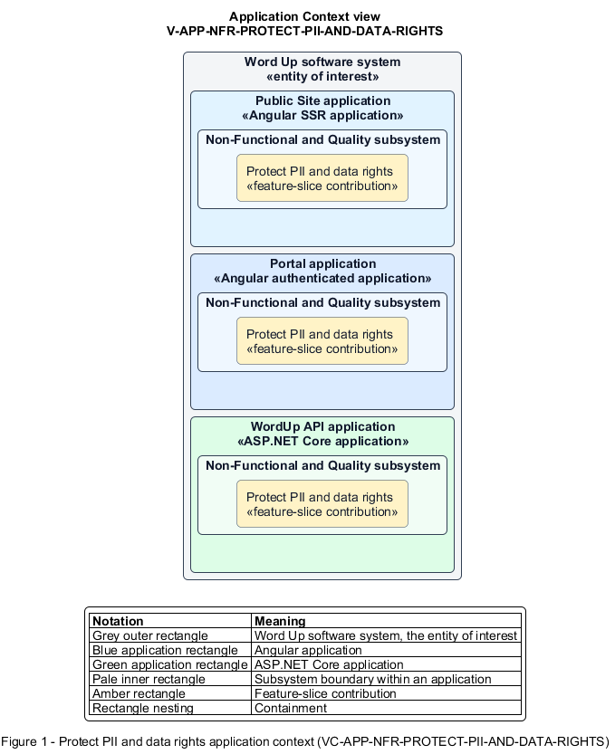

# Protect PII and data rights

## Identification and scope

The Word Up software system is the entity of interest (EoI). The Protect PII and data rights feature slice (`FS-NFR-PROTECT-PII-AND-DATA-RIGHTS`) is an architecture description element in the Non-Functional and Quality subsystem.

| Item | Identification |
| --- | --- |
| Participating applications | Public Site application; Portal application; WordUp API application |
| Architecture view | Application Context view (`V-APP-NFR-PROTECT-PII-AND-DATA-RIGHTS`) |
| Governing viewpoint | Application Context viewpoint (`VP-APP-CONTEXT`) |
| View component | Nested Application Context component (`VC-APP-NFR-PROTECT-PII-AND-DATA-RIGHTS`) |

This focused description addresses feature scope, behavior, application context, and requirement correspondences. It does not claim conformance as a complete architecture description.

## Overview

The Protect PII and data rights feature slice carries personal data from collection through restricted use, correction, withdrawal, and retention.

## Application context

The Application Context view (`V-APP-NFR-PROTECT-PII-AND-DATA-RIGHTS`) applies the Application Context viewpoint (`VP-APP-CONTEXT`) to the Word Up software system. The viewpoint frames the application-location concern (`C-APP-LOCATION`). The view component (`VC-APP-NFR-PROTECT-PII-AND-DATA-RIGHTS`) uses the nested-containment model kind.

Nested rectangles identify the EoI, each participating application, the subsystem boundary, and the feature-slice contribution. Figure 1 presents the view component.

*Figure 1 — Application Context view: the Protect PII and data rights feature slice within the participating Word Up applications.*

## Behavior

- **Entry.** The platform stores personal data or receives an access, correction, removal, or consent-withdrawal request.
- **Processing.** The API minimizes stored data, protects sensitive fields at rest, and restricts access through assignments. The API records subject actions and removes or anonymizes expired data. Operational logs redact secrets and PII.
- **Result.** The organization can fulfil data-subject rights while preserving authorized de-identified reporting.

## Scope boundary

Guardian consent semantics and role authorization provide related but independently testable rules.

## Correspondences

The requirement-trace correspondence method (`M-REQ-TRACE`) relates stable L2 requirement identifiers to feature slices. The Protect PII and data rights requirement correspondence (`COR-REQ-NFR-PROTECT-PII-AND-DATA-RIGHTS`) records the following relationships.

| Requirement | Relationship |
| --- | --- |
| `L2-NFR-003` | Primary requirement |
| `L2-CONSENT-001` | Dependency |
| `L2-AUTH-010` | Dependency |
| `L2-NFR-011` | Dependency |
