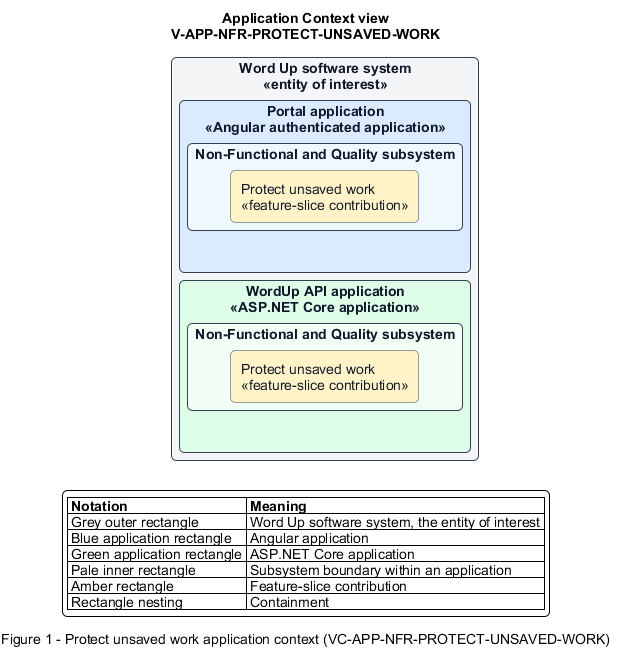

# Protect unsaved work

## Identification and scope

The Word Up software system is the entity of interest (EoI). The Protect unsaved work feature slice (`FS-NFR-PROTECT-UNSAVED-WORK`) is an architecture description element in the Non-Functional and Quality subsystem.

| Item | Identification |
| --- | --- |
| Participating applications | Portal application; WordUp API application |
| Architecture view | Application Context view (`V-APP-NFR-PROTECT-UNSAVED-WORK`) |
| Governing viewpoint | Application Context viewpoint (`VP-APP-CONTEXT`) |
| View component | Nested Application Context component (`VC-APP-NFR-PROTECT-UNSAVED-WORK`) |

This focused description addresses feature scope, behavior, application context, and requirement correspondences. It does not claim conformance as a complete architecture description.

## Overview

The Protect unsaved work feature slice prevents accidental loss while users edit reflections, attendance, grading, or curriculum.

## Application context

The Application Context view (`V-APP-NFR-PROTECT-UNSAVED-WORK`) applies the Application Context viewpoint (`VP-APP-CONTEXT`) to the Word Up software system. The viewpoint frames the application-location concern (`C-APP-LOCATION`). The view component (`VC-APP-NFR-PROTECT-UNSAVED-WORK`) uses the nested-containment model kind.

Nested rectangles identify the EoI, each participating application, the subsystem boundary, and the feature-slice contribution. Figure 1 presents the view component.

*Figure 1 — Application Context view: the Protect unsaved work feature slice within the participating Word Up applications.*

## Behavior

- **Entry.** A dirty form is about to be abandoned, closed, signed out, or interrupted.
- **Processing.** The UI detects unsaved state, warns before navigation, offers cancel or draft save where supported, and restores the persisted draft on return.
- **Result.** A user makes an explicit choice before discarding work and can recover saved drafts.

## Scope boundary

The owning feature defines draft content and final submission rules.

## Correspondences

The requirement-trace correspondence method (`M-REQ-TRACE`) relates stable L2 requirement identifiers to feature slices. The Protect unsaved work requirement correspondence (`COR-REQ-NFR-PROTECT-UNSAVED-WORK`) records the following relationships.

| Requirement | Relationship |
| --- | --- |
| `L2-NFR-007` | Primary requirement |
