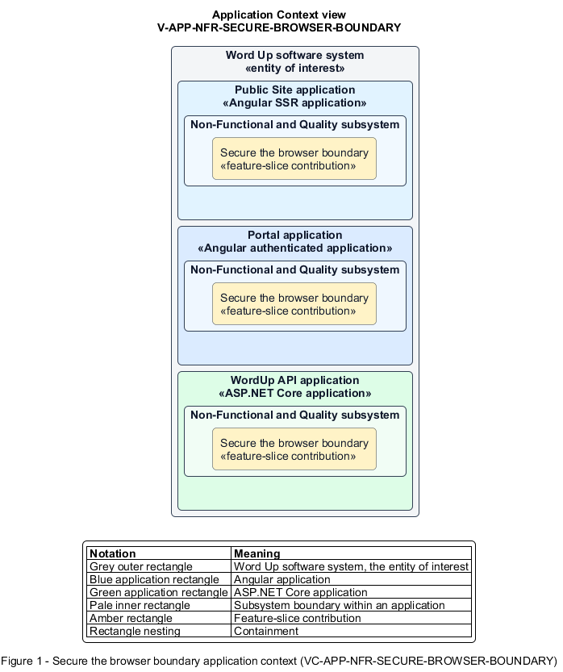

# Secure the browser boundary

## Identification and scope

The Word Up software system is the entity of interest (EoI). The Secure the browser boundary feature slice (`FS-NFR-SECURE-BROWSER-BOUNDARY`) is an architecture description element in the Non-Functional and Quality subsystem.

| Item | Identification |
| --- | --- |
| Participating applications | Public Site application; Portal application; WordUp API application |
| Architecture view | Application Context view (`V-APP-NFR-SECURE-BROWSER-BOUNDARY`) |
| Governing viewpoint | Application Context viewpoint (`VP-APP-CONTEXT`) |
| View component | Nested Application Context component (`VC-APP-NFR-SECURE-BROWSER-BOUNDARY`) |

This focused description addresses feature scope, behavior, application context, and requirement correspondences. It does not claim conformance as a complete architecture description.

## Overview

The Secure the browser boundary feature slice applies cross-site, transport-adjacent, and abuse controls to browser-facing endpoints.

## Application context

The Application Context view (`V-APP-NFR-SECURE-BROWSER-BOUNDARY`) applies the Application Context viewpoint (`VP-APP-CONTEXT`) to the Word Up software system. The viewpoint frames the application-location concern (`C-APP-LOCATION`). The view component (`VC-APP-NFR-SECURE-BROWSER-BOUNDARY`) uses the nested-containment model kind.

Nested rectangles identify the EoI, each participating application, the subsystem boundary, and the feature-slice contribution. Figure 1 presents the view component.

*Figure 1 — Application Context view: the Secure the browser boundary feature slice within the participating Word Up applications.*

## Behavior

- **Entry.** A browser makes a request to the web application or API.
- **Processing.** The boundary enforces scheme-appropriate CSRF, environment-specific CORS allowlists, CSP and related security headers, HSTS in production, and rate limits on sign-in, reset, and invitation endpoints.
- **Result.** Unapproved origins, framing, content sniffing, cross-site mutations, and high-rate sensitive calls are rejected or constrained.

## Scope boundary

Credential verification and request-payload validation remain separate slices.

## Correspondences

The requirement-trace correspondence method (`M-REQ-TRACE`) relates stable L2 requirement identifiers to feature slices. The Secure the browser boundary requirement correspondence (`COR-REQ-NFR-SECURE-BROWSER-BOUNDARY`) records the following relationships.

| Requirement | Relationship |
| --- | --- |
| `L2-NFR-002` | Primary requirement |
| `L2-AUTH-001` | Dependency |
