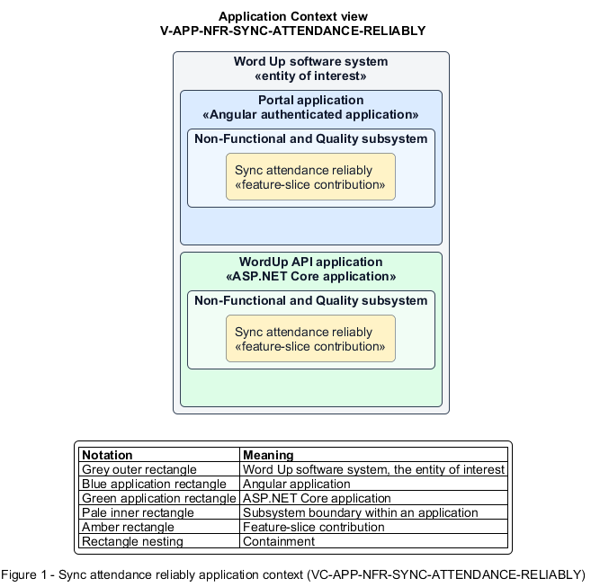

# Sync attendance reliably

## Identification and scope

The Word Up software system is the entity of interest (EoI). The Sync attendance reliably feature slice (`FS-NFR-SYNC-ATTENDANCE-RELIABLY`) is an architecture description element in the Non-Functional and Quality subsystem.

| Item | Identification |
| --- | --- |
| Participating applications | Portal application; WordUp API application |
| Architecture view | Application Context view (`V-APP-NFR-SYNC-ATTENDANCE-RELIABLY`) |
| Governing viewpoint | Application Context viewpoint (`VP-APP-CONTEXT`) |
| View component | Nested Application Context component (`VC-APP-NFR-SYNC-ATTENDANCE-RELIABLY`) |

This focused description addresses feature scope, behavior, application context, and requirement correspondences. It does not claim conformance as a complete architecture description.

## Overview

The Sync attendance reliably feature slice is the reusable integrity contract behind offline attendance on mentor and volunteer devices.

## Application context

The Application Context view (`V-APP-NFR-SYNC-ATTENDANCE-RELIABLY`) applies the Application Context viewpoint (`VP-APP-CONTEXT`) to the Word Up software system. The viewpoint frames the application-location concern (`C-APP-LOCATION`). The view component (`VC-APP-NFR-SYNC-ATTENDANCE-RELIABLY`) uses the nested-containment model kind.

Nested rectangles identify the EoI, each participating application, the subsystem boundary, and the feature-slice contribution. Figure 1 presents the view component.

*Figure 1 — Application Context view: the Sync attendance reliably feature slice within the participating Word Up applications.*

## Behavior

- **Entry.** An authorized device records attendance without connectivity and later reconnects.
- **Processing.** Each private queued write carries replay context and an idempotency key, syncs only for the signed-in owner, applies exactly once, and reports deterministic conflict outcomes.
- **Result.** Retries and reconnects produce no lost, duplicated, or cross-account attendance data.

## Scope boundary

The Record Attendance and Sync Offline Attendance feature slices define roster interaction and attendance business statuses.

## Correspondences

The requirement-trace correspondence method (`M-REQ-TRACE`) relates stable L2 requirement identifiers to feature slices. The Sync attendance reliably requirement correspondence (`COR-REQ-NFR-SYNC-ATTENDANCE-RELIABLY`) records the following relationships.

| Requirement | Relationship |
| --- | --- |
| `L2-NFR-004` | Primary requirement |
| `L2-ENGAGE-003` | Dependency |
| `L2-NFR-006` | Dependency |
