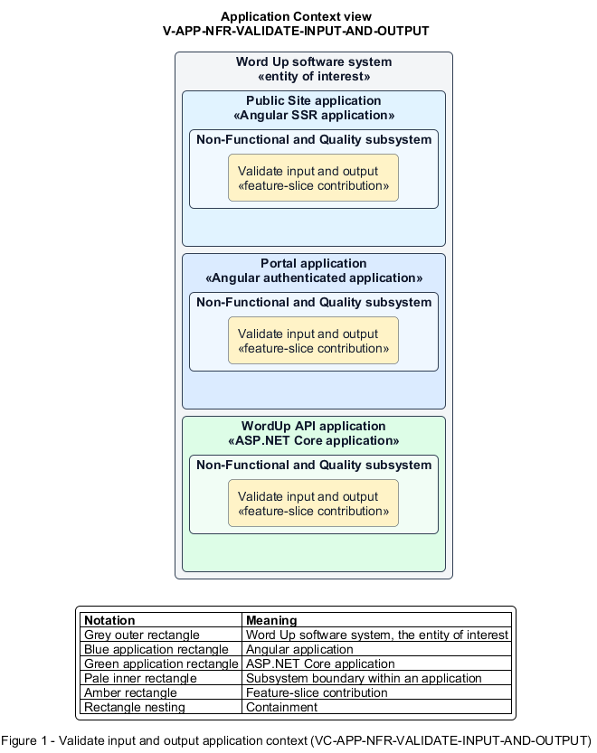

# Validate input and output

## Identification and scope

The Word Up software system is the entity of interest (EoI). The Validate input and output feature slice (`FS-NFR-VALIDATE-INPUT-AND-OUTPUT`) is an architecture description element in the Non-Functional and Quality subsystem.

| Item | Identification |
| --- | --- |
| Participating applications | Public Site application; Portal application; WordUp API application |
| Architecture view | Application Context view (`V-APP-NFR-VALIDATE-INPUT-AND-OUTPUT`) |
| Governing viewpoint | Application Context viewpoint (`VP-APP-CONTEXT`) |
| View component | Nested Application Context component (`VC-APP-NFR-VALIDATE-INPUT-AND-OUTPUT`) |

This focused description addresses feature scope, behavior, application context, and requirement correspondences. It does not claim conformance as a complete architecture description.

## Overview

The Validate input and output feature slice provides a complete safe-data path from untrusted request to rendered or stored result.

## Application context

The Application Context view (`V-APP-NFR-VALIDATE-INPUT-AND-OUTPUT`) applies the Application Context viewpoint (`VP-APP-CONTEXT`) to the Word Up software system. The viewpoint frames the application-location concern (`C-APP-LOCATION`). The view component (`VC-APP-NFR-VALIDATE-INPUT-AND-OUTPUT`) uses the nested-containment model kind.

Nested rectangles identify the EoI, each participating application, the subsystem boundary, and the feature-slice contribution. Figure 1 presents the view component.

*Figure 1 — Application Context view: the Validate input and output feature slice within the participating Word Up applications.*

## Behavior

- **Entry.** A request supplies structured fields, free text, query values, or a file upload.
- **Processing.** The server validates schemas, ranges, formats, and file content, uses parameterized data access, stores uploads without executable exposure, and contextually encodes user text on output.
- **Result.** Invalid input returns structured errors and accepted input cannot become SQL, script, or file-based injection.

## Scope boundary

Authentication, business rules, and browser-origin defenses are separate controls layered on this contract.

## Correspondences

The requirement-trace correspondence method (`M-REQ-TRACE`) relates stable L2 requirement identifiers to feature slices. The Validate input and output requirement correspondence (`COR-REQ-NFR-VALIDATE-INPUT-AND-OUTPUT`) records the following relationships.

| Requirement | Relationship |
| --- | --- |
| `L2-NFR-001` | Primary requirement |
