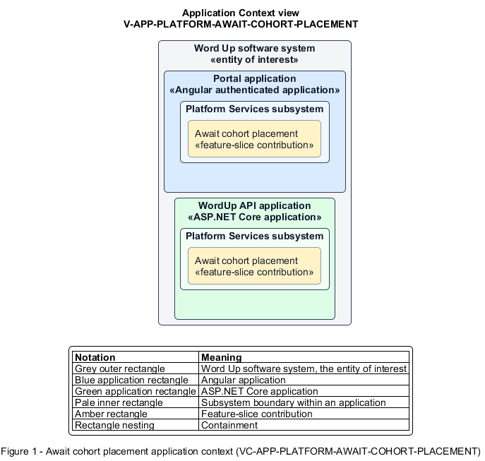

# Await cohort placement

## Identification and scope

The Word Up software system is the entity of interest (EoI). The Await cohort placement feature slice (`FS-PLATFORM-AWAIT-COHORT-PLACEMENT`) is an architecture description element in the Platform Services subsystem.

| Item | Identification |
| --- | --- |
| Participating applications | Portal application; WordUp API application |
| Architecture view | Application Context view (`V-APP-PLATFORM-AWAIT-COHORT-PLACEMENT`) |
| Governing viewpoint | Application Context viewpoint (`VP-APP-CONTEXT`) |
| View component | Nested Application Context component (`VC-APP-PLATFORM-AWAIT-COHORT-PLACEMENT`) |

This focused description addresses feature scope, behavior, application context, and requirement correspondences. It does not claim conformance as a complete architecture description.

## Overview

The Await cohort placement feature slice provides an authenticated youth a safe holding state before program placement is complete.

## Application context

The Application Context view (`V-APP-PLATFORM-AWAIT-COHORT-PLACEMENT`) applies the Application Context viewpoint (`VP-APP-CONTEXT`) to the Word Up software system. The viewpoint frames the application-location concern (`C-APP-LOCATION`). The view component (`VC-APP-PLATFORM-AWAIT-COHORT-PLACEMENT`) uses the nested-containment model kind.

Nested rectangles identify the EoI, each participating application, the subsystem boundary, and the feature-slice contribution. Figure 1 presents the view component.

*Figure 1 — Application Context view: the Await cohort placement feature slice within the participating Word Up applications.*

## Behavior

- **Entry.** A youth signs in without an active cohort enrollment.
- **Processing.** The server keeps program content locked and the UI explains that placement is pending with a Message mentor path.
- **Result.** The youth can seek assistance without seeing curriculum or data outside an enrollment.

## Scope boundary

Creating the enrollment belongs to Application Intake or Program Administration.

## Correspondences

The requirement-trace correspondence method (`M-REQ-TRACE`) relates stable L2 requirement identifiers to feature slices. The Await cohort placement requirement correspondence (`COR-REQ-PLATFORM-AWAIT-COHORT-PLACEMENT`) records the following relationships.

| Requirement | Relationship |
| --- | --- |
| `L2-PLATFORM-011` | Primary requirement |
| `L2-INTAKE-002` | Dependency |
| `L2-ADMIN-003` | Dependency |
