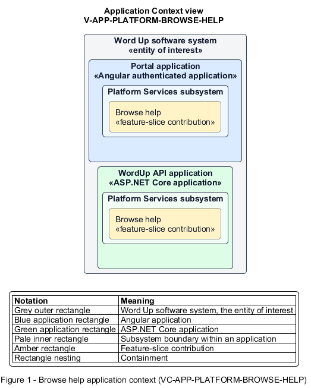

# Browse help

## Identification and scope

The Word Up software system is the entity of interest (EoI). The Browse help feature slice (`FS-PLATFORM-BROWSE-HELP`) is an architecture description element in the Platform Services subsystem.

| Item | Identification |
| --- | --- |
| Participating applications | Portal application; WordUp API application |
| Architecture view | Application Context view (`V-APP-PLATFORM-BROWSE-HELP`) |
| Governing viewpoint | Application Context viewpoint (`VP-APP-CONTEXT`) |
| View component | Nested Application Context component (`VC-APP-PLATFORM-BROWSE-HELP`) |

This focused description addresses feature scope, behavior, application context, and requirement correspondences. It does not claim conformance as a complete architecture description.

## Overview

The Browse help feature slice allows a signed-in user find role-appropriate self-service guidance.

## Application context

The Application Context view (`V-APP-PLATFORM-BROWSE-HELP`) applies the Application Context viewpoint (`VP-APP-CONTEXT`) to the Word Up software system. The viewpoint frames the application-location concern (`C-APP-LOCATION`). The view component (`VC-APP-PLATFORM-BROWSE-HELP`) uses the nested-containment model kind.

Nested rectangles identify the EoI, each participating application, the subsystem boundary, and the feature-slice contribution. Figure 1 presents the view component.

*Figure 1 — Application Context view: the Browse help feature slice within the participating Word Up applications.*

## Behavior

- **Entry.** A user opens the Help Center and selects or searches a topic.
- **Processing.** The service returns published FAQ and topic content filtered or organized for the user's role, with accessible navigation and useful empty states.
- **Result.** The user can resolve a common question or continue to the support request path.

## Scope boundary

Submitting and routing a support case is a separate slice.

## Correspondences

The requirement-trace correspondence method (`M-REQ-TRACE`) relates stable L2 requirement identifiers to feature slices. The Browse help requirement correspondence (`COR-REQ-PLATFORM-BROWSE-HELP`) records the following relationships.

| Requirement | Relationship |
| --- | --- |
| `L2-PLATFORM-005` | Primary requirement |
| `L2-AUTH-010` | Dependency |
