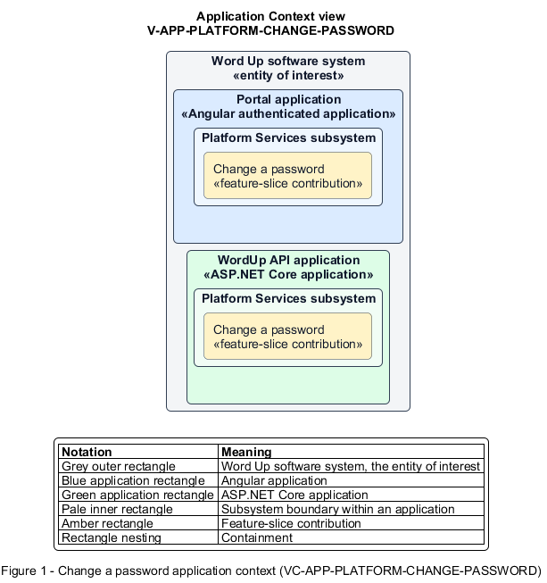

# Change a password

## Identification and scope

The Word Up software system is the entity of interest (EoI). The Change a password feature slice (`FS-PLATFORM-CHANGE-PASSWORD`) is an architecture description element in the Platform Services subsystem.

| Item | Identification |
| --- | --- |
| Participating applications | Portal application; WordUp API application |
| Architecture view | Application Context view (`V-APP-PLATFORM-CHANGE-PASSWORD`) |
| Governing viewpoint | Application Context viewpoint (`VP-APP-CONTEXT`) |
| View component | Nested Application Context component (`VC-APP-PLATFORM-CHANGE-PASSWORD`) |

This focused description addresses feature scope, behavior, application context, and requirement correspondences. It does not claim conformance as a complete architecture description.

## Overview

The Change a password feature slice allows an authenticated user replace their password and close other sessions.

## Application context

The Application Context view (`V-APP-PLATFORM-CHANGE-PASSWORD`) applies the Application Context viewpoint (`VP-APP-CONTEXT`) to the Word Up software system. The viewpoint frames the application-location concern (`C-APP-LOCATION`). The view component (`VC-APP-PLATFORM-CHANGE-PASSWORD`) uses the nested-containment model kind.

Nested rectangles identify the EoI, each participating application, the subsystem boundary, and the feature-slice contribution. Figure 1 presents the view component.

*Figure 1 — Application Context view: the Change a password feature slice within the participating Word Up applications.*

## Behavior

- **Entry.** A user submits the current password, a policy-compliant new password, and matching confirmation.
- **Processing.** The server verifies the current credential, applies the shared password policy and hashing contract, updates the password, and revokes all other refresh sessions.
- **Result.** The new password is active and other devices require new authentication.

## Scope boundary

Forgot-password recovery does not require a current credential and is a separate slice.

## Correspondences

The requirement-trace correspondence method (`M-REQ-TRACE`) relates stable L2 requirement identifiers to feature slices. The Change a password requirement correspondence (`COR-REQ-PLATFORM-CHANGE-PASSWORD`) records the following relationships.

| Requirement | Relationship |
| --- | --- |
| `L2-PLATFORM-002` | Primary requirement |
| `L2-AUTH-008` | Dependency |
| `L2-AUTH-012` | Dependency |
