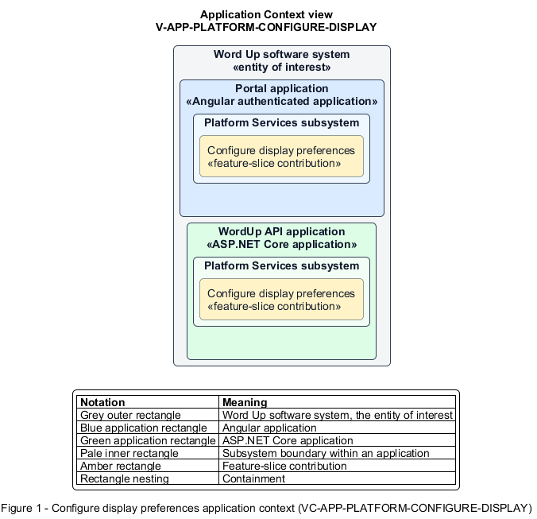

# Configure display preferences

## Identification and scope

The Word Up software system is the entity of interest (EoI). The Configure display preferences feature slice (`FS-PLATFORM-CONFIGURE-DISPLAY`) is an architecture description element in the Platform Services subsystem.

| Item | Identification |
| --- | --- |
| Participating applications | Portal application; WordUp API application |
| Architecture view | Application Context view (`V-APP-PLATFORM-CONFIGURE-DISPLAY`) |
| Governing viewpoint | Application Context viewpoint (`VP-APP-CONTEXT`) |
| View component | Nested Application Context component (`VC-APP-PLATFORM-CONFIGURE-DISPLAY`) |

This focused description addresses feature scope, behavior, application context, and requirement correspondences. It does not claim conformance as a complete architecture description.

## Overview

The Configure display preferences feature slice allows a user personalize readability and motion across the application.

## Application context

The Application Context view (`V-APP-PLATFORM-CONFIGURE-DISPLAY`) applies the Application Context viewpoint (`VP-APP-CONTEXT`) to the Word Up software system. The viewpoint frames the application-location concern (`C-APP-LOCATION`). The view component (`VC-APP-PLATFORM-CONFIGURE-DISPLAY`) uses the nested-containment model kind.

Nested rectangles identify the EoI, each participating application, the subsystem boundary, and the feature-slice contribution. Figure 1 presents the view component.

*Figure 1 — Application Context view: the Configure display preferences feature slice within the participating Word Up applications.*

## Behavior

- **Entry.** A user changes text size, high contrast, reduced motion, underlined links, or reading font.
- **Processing.** The settings page provides live preview, validates and persists choices, and the application shell applies them consistently; reduced motion suppresses nonessential animations.
- **Result.** Current and future pages honor the user's accessibility and reading preferences.

## Scope boundary

The application shall meet the baseline accessibility standard when no preference is set.

## Correspondences

The requirement-trace correspondence method (`M-REQ-TRACE`) relates stable L2 requirement identifiers to feature slices. The Configure display preferences requirement correspondence (`COR-REQ-PLATFORM-CONFIGURE-DISPLAY`) records the following relationships.

| Requirement | Relationship |
| --- | --- |
| `L2-PLATFORM-004` | Primary requirement |
| `L2-NFR-010` | Dependency |
