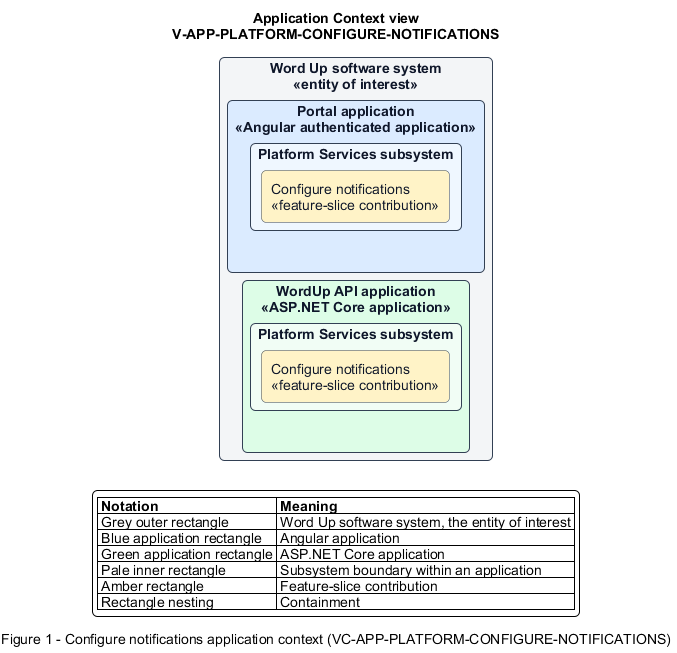

# Configure notifications

## Identification and scope

The Word Up software system is the entity of interest (EoI). The Configure notifications feature slice (`FS-PLATFORM-CONFIGURE-NOTIFICATIONS`) is an architecture description element in the Platform Services subsystem.

| Item | Identification |
| --- | --- |
| Participating applications | Portal application; WordUp API application |
| Architecture view | Application Context view (`V-APP-PLATFORM-CONFIGURE-NOTIFICATIONS`) |
| Governing viewpoint | Application Context viewpoint (`VP-APP-CONTEXT`) |
| View component | Nested Application Context component (`VC-APP-PLATFORM-CONFIGURE-NOTIFICATIONS`) |

This focused description addresses feature scope, behavior, application context, and requirement correspondences. It does not claim conformance as a complete architecture description.

## Overview

The Configure notifications feature slice allows each user choose which event types reach them in-app or by optional email.

## Application context

The Application Context view (`V-APP-PLATFORM-CONFIGURE-NOTIFICATIONS`) applies the Application Context viewpoint (`VP-APP-CONTEXT`) to the Word Up software system. The viewpoint frames the application-location concern (`C-APP-LOCATION`). The view component (`VC-APP-PLATFORM-CONFIGURE-NOTIFICATIONS`) uses the nested-containment model kind.

Nested rectangles identify the EoI, each participating application, the subsystem boundary, and the feature-slice contribution. Figure 1 presents the view component.

*Figure 1 — Application Context view: the Configure notifications feature slice within the participating Word Up applications.*

## Behavior

- **Entry.** A user opens Notification Settings and changes per-event channel toggles.
- **Processing.** The server persists preferences for lessons, graded work, messages, reminders, and other supported events, and notification generation consults them before each channel delivery.
- **Result.** Future events use the user's current channel choices without affecting unauthorized recipient scoping.

## Scope boundary

Creating feed items and delivering live events are Engagement and Non-Functional slices.

## Correspondences

The requirement-trace correspondence method (`M-REQ-TRACE`) relates stable L2 requirement identifiers to feature slices. The Configure notifications requirement correspondence (`COR-REQ-PLATFORM-CONFIGURE-NOTIFICATIONS`) records the following relationships.

| Requirement | Relationship |
| --- | --- |
| `L2-PLATFORM-003` | Primary requirement |
| `L2-ENGAGE-008` | Dependency |
