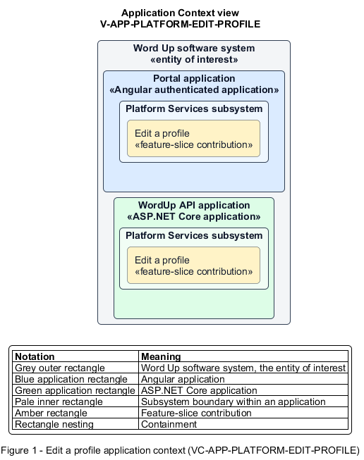

# Edit a profile

## Identification and scope

The Word Up software system is the entity of interest (EoI). The Edit a profile feature slice (`FS-PLATFORM-EDIT-PROFILE`) is an architecture description element in the Platform Services subsystem.

| Item | Identification |
| --- | --- |
| Participating applications | Portal application; WordUp API application |
| Architecture view | Application Context view (`V-APP-PLATFORM-EDIT-PROFILE`) |
| Governing viewpoint | Application Context viewpoint (`VP-APP-CONTEXT`) |
| View component | Nested Application Context component (`VC-APP-PLATFORM-EDIT-PROFILE`) |

This focused description addresses feature scope, behavior, application context, and requirement correspondences. It does not claim conformance as a complete architecture description.

## Overview

The Edit a profile feature slice allows a signed-in user keep editable profile details and photo current while respecting managed fields.

## Application context

The Application Context view (`V-APP-PLATFORM-EDIT-PROFILE`) applies the Application Context viewpoint (`VP-APP-CONTEXT`) to the Word Up software system. The viewpoint frames the application-location concern (`C-APP-LOCATION`). The view component (`VC-APP-PLATFORM-EDIT-PROFILE`) uses the nested-containment model kind.

Nested rectangles identify the EoI, each participating application, the subsystem boundary, and the feature-slice contribution. Figure 1 presents the view component.

*Figure 1 — Application Context view: the Edit a profile feature slice within the participating Word Up applications.*

## Behavior

- **Entry.** A user opens Profile Settings and changes their name, email, or photo.
- **Processing.** The form marks cohort and other managed fields read-only and validates required names and email. The API validates image type and size, authorizes the subject, and persists the profile and image.
- **Result.** The user's permitted profile changes appear consistently across the application.

## Scope boundary

Password change, guardian contact records, and administrator account management are separate slices.

## Correspondences

The requirement-trace correspondence method (`M-REQ-TRACE`) relates stable L2 requirement identifiers to feature slices. The Edit a profile requirement correspondence (`COR-REQ-PLATFORM-EDIT-PROFILE`) records the following relationships.

| Requirement | Relationship |
| --- | --- |
| `L2-PLATFORM-002` | Primary requirement |
| `L2-NFR-001` | Dependency |
| `L2-AUTH-010` | Dependency |
