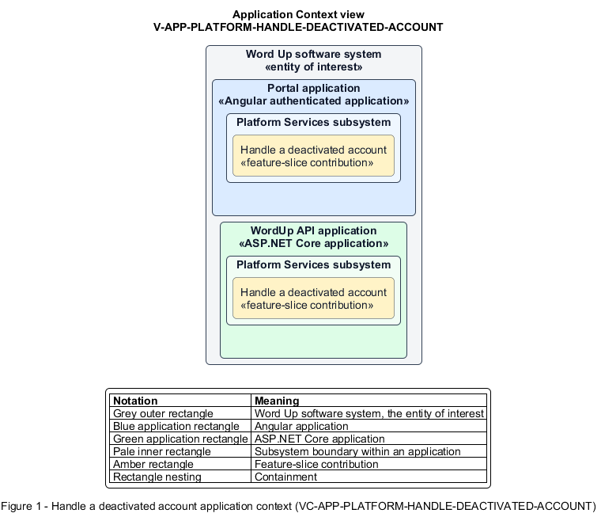

# Handle a deactivated account

## Identification and scope

The Word Up software system is the entity of interest (EoI). The Handle a deactivated account feature slice (`FS-PLATFORM-HANDLE-DEACTIVATED-ACCOUNT`) is an architecture description element in the Platform Services subsystem.

| Item | Identification |
| --- | --- |
| Participating applications | Portal application; WordUp API application |
| Architecture view | Application Context view (`V-APP-PLATFORM-HANDLE-DEACTIVATED-ACCOUNT`) |
| Governing viewpoint | Application Context viewpoint (`VP-APP-CONTEXT`) |
| View component | Nested Application Context component (`VC-APP-PLATFORM-HANDLE-DEACTIVATED-ACCOUNT`) |

This focused description addresses feature scope, behavior, application context, and requirement correspondences. It does not claim conformance as a complete architecture description.

## Overview

The Handle a deactivated account feature slice clearly refuses access to a person whose account has been deactivated.

## Application context

The Application Context view (`V-APP-PLATFORM-HANDLE-DEACTIVATED-ACCOUNT`) applies the Application Context viewpoint (`VP-APP-CONTEXT`) to the Word Up software system. The viewpoint frames the application-location concern (`C-APP-LOCATION`). The view component (`VC-APP-PLATFORM-HANDLE-DEACTIVATED-ACCOUNT`) uses the nested-containment model kind.

Nested rectangles identify the EoI, each participating application, the subsystem boundary, and the feature-slice contribution. Figure 1 presents the view component.

*Figure 1 — Application Context view: the Handle a deactivated account feature slice within the participating Word Up applications.*

## Behavior

- **Entry.** A deactivated user attempts to sign in or use an obsolete session.
- **Processing.** Authentication is refused, sessions remain unusable, and the account-inactive state provides a path to contact the director without revealing protected account data.
- **Result.** The user understands how to seek help while deactivation remains fully enforced.

## Scope boundary

Administrators deactivate and reactivate accounts in Program Administration.

## Correspondences

The requirement-trace correspondence method (`M-REQ-TRACE`) relates stable L2 requirement identifiers to feature slices. The Handle a deactivated account requirement correspondence (`COR-REQ-PLATFORM-HANDLE-DEACTIVATED-ACCOUNT`) records the following relationships.

| Requirement | Relationship |
| --- | --- |
| `L2-PLATFORM-010` | Primary requirement |
| `L2-ADMIN-002` | Dependency |
| `L2-AUTH-009` | Dependency |
