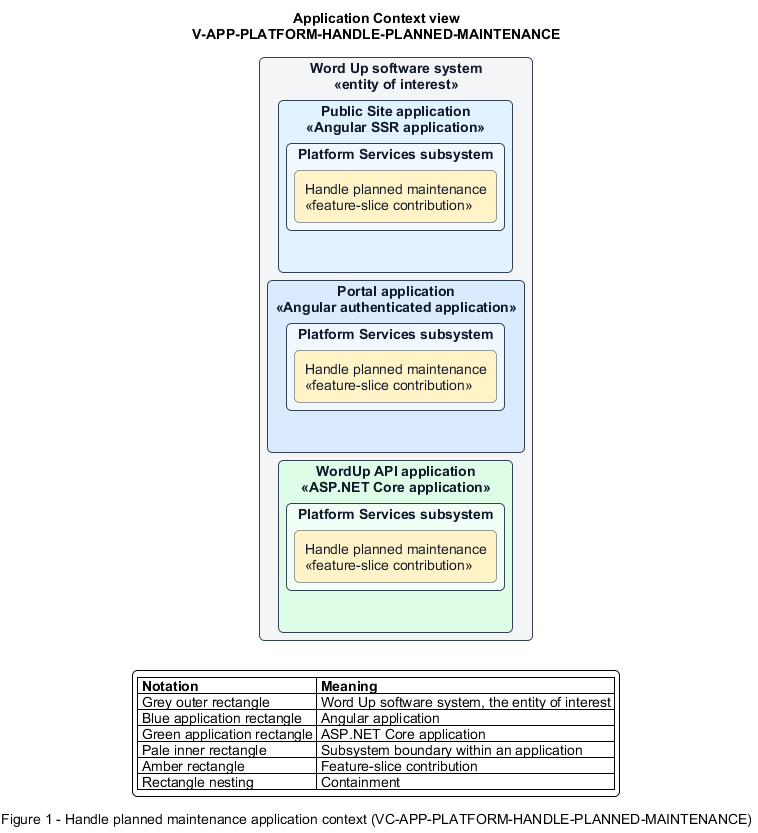

# Handle planned maintenance

## Identification and scope

The Word Up software system is the entity of interest (EoI). The Handle planned maintenance feature slice (`FS-PLATFORM-HANDLE-PLANNED-MAINTENANCE`) is an architecture description element in the Platform Services subsystem.

| Item | Identification |
| --- | --- |
| Participating applications | Public Site application; Portal application; WordUp API application |
| Architecture view | Application Context view (`V-APP-PLATFORM-HANDLE-PLANNED-MAINTENANCE`) |
| Governing viewpoint | Application Context viewpoint (`VP-APP-CONTEXT`) |
| View component | Nested Application Context component (`VC-APP-PLATFORM-HANDLE-PLANNED-MAINTENANCE`) |

This focused description addresses feature scope, behavior, application context, and requirement correspondences. It does not claim conformance as a complete architecture description.

## Overview

The Handle planned maintenance feature slice provides users and clients an explicit, recoverable state while the platform is intentionally unavailable.

## Application context

The Application Context view (`V-APP-PLATFORM-HANDLE-PLANNED-MAINTENANCE`) applies the Application Context viewpoint (`VP-APP-CONTEXT`) to the Word Up software system. The viewpoint frames the application-location concern (`C-APP-LOCATION`). The view component (`VC-APP-PLATFORM-HANDLE-PLANNED-MAINTENANCE`) uses the nested-containment model kind.

Nested rectangles identify the EoI, each participating application, the subsystem boundary, and the feature-slice contribution. Figure 1 presents the view component.

*Figure 1 — Application Context view: the Handle planned maintenance feature slice within the participating Word Up applications.*

## Behavior

- **Entry.** Maintenance mode is active when a page or API request arrives.
- **Processing.** Pages show a 503 maintenance message, reassurance, and Check again action; APIs return 503 with a Retry-After indication rather than partial application behavior.
- **Result.** Users know the outage is temporary and clients know when to retry.

## Scope boundary

Deployment orchestration and health probes are operational concerns outside this presentation slice.

## Correspondences

The requirement-trace correspondence method (`M-REQ-TRACE`) relates stable L2 requirement identifiers to feature slices. The Handle planned maintenance requirement correspondence (`COR-REQ-PLATFORM-HANDLE-PLANNED-MAINTENANCE`) records the following relationships.

| Requirement | Relationship |
| --- | --- |
| `L2-PLATFORM-009` | Primary requirement |
