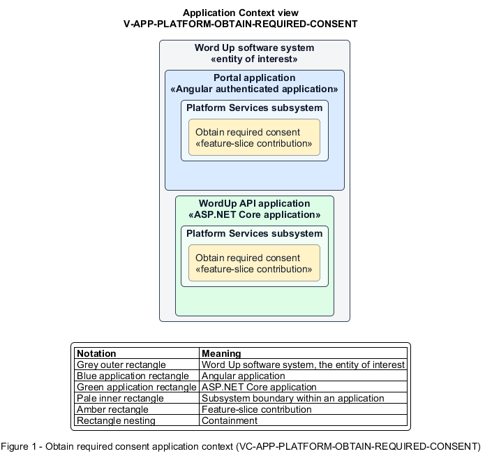

# Obtain required consent

## Identification and scope

The Word Up software system is the entity of interest (EoI). The Obtain required consent feature slice (`FS-PLATFORM-OBTAIN-REQUIRED-CONSENT`) is an architecture description element in the Platform Services subsystem.

| Item | Identification |
| --- | --- |
| Participating applications | Portal application; WordUp API application |
| Architecture view | Application Context view (`V-APP-PLATFORM-OBTAIN-REQUIRED-CONSENT`) |
| Governing viewpoint | Application Context viewpoint (`VP-APP-CONTEXT`) |
| View component | Nested Application Context component (`VC-APP-PLATFORM-OBTAIN-REQUIRED-CONSENT`) |

This focused description addresses feature scope, behavior, application context, and requirement correspondences. It does not claim conformance as a complete architecture description.

## Overview

The Obtain required consent feature slice provides a minor a clear recovery route when participation consent is missing.

## Application context

The Application Context view (`V-APP-PLATFORM-OBTAIN-REQUIRED-CONSENT`) applies the Application Context viewpoint (`VP-APP-CONTEXT`) to the Word Up software system. The viewpoint frames the application-location concern (`C-APP-LOCATION`). The view component (`VC-APP-PLATFORM-OBTAIN-REQUIRED-CONSENT`) uses the nested-containment model kind.

Nested rectangles identify the EoI, each participating application, the subsystem boundary, and the feature-slice contribution. Figure 1 presents the view component.

*Figure 1 — Application Context view: the Obtain required consent feature slice within the participating Word Up applications.*

## Behavior

- **Entry.** Consent gating holds a signed-in youth before program content.
- **Processing.** The state explains the requirement, keeps protected content locked, offers Notify my guardian, and exposes a secure immediate guardian-sign path.
- **Result.** The platform sends a consent request or records completed consent. The consent gate then re-evaluates youth access.

## Scope boundary

Consent validity and e-signature persistence belong to Consent and Safeguarding.

## Correspondences

The requirement-trace correspondence method (`M-REQ-TRACE`) relates stable L2 requirement identifiers to feature slices. The Obtain required consent requirement correspondence (`COR-REQ-PLATFORM-OBTAIN-REQUIRED-CONSENT`) records the following relationships.

| Requirement | Relationship |
| --- | --- |
| `L2-PLATFORM-011` | Primary requirement |
| `L2-CONSENT-002` | Dependency |
