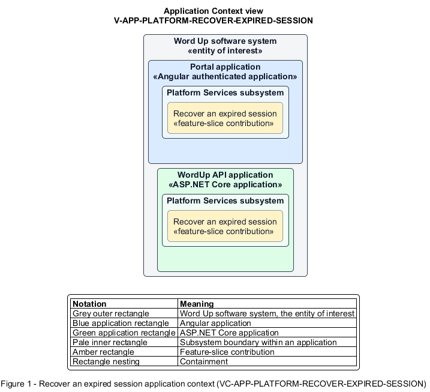

# Recover an expired session

## Identification and scope

The Word Up software system is the entity of interest (EoI). The Recover an expired session feature slice (`FS-PLATFORM-RECOVER-EXPIRED-SESSION`) is an architecture description element in the Platform Services subsystem.

| Item | Identification |
| --- | --- |
| Participating applications | Portal application; WordUp API application |
| Architecture view | Application Context view (`V-APP-PLATFORM-RECOVER-EXPIRED-SESSION`) |
| Governing viewpoint | Application Context viewpoint (`VP-APP-CONTEXT`) |
| View component | Nested Application Context component (`VC-APP-PLATFORM-RECOVER-EXPIRED-SESSION`) |

This focused description addresses feature scope, behavior, application context, and requirement correspondences. It does not claim conformance as a complete architecture description.

## Overview

The Recover an expired session feature slice returns an idle user to authentication without discarding recoverable work.

## Application context

The Application Context view (`V-APP-PLATFORM-RECOVER-EXPIRED-SESSION`) applies the Application Context viewpoint (`VP-APP-CONTEXT`) to the Word Up software system. The viewpoint frames the application-location concern (`C-APP-LOCATION`). The view component (`VC-APP-PLATFORM-RECOVER-EXPIRED-SESSION`) uses the nested-containment model kind.

Nested rectangles identify the EoI, each participating application, the subsystem boundary, and the feature-slice contribution. Figure 1 presents the view component.

*Figure 1 — Application Context view: the Recover an expired session feature slice within the participating Word Up applications.*

## Behavior

- **Entry.** An expired authenticated session is detected when the user next acts.
- **Processing.** The application preserves supported drafts, clears inaccessible account state, shows the session-expired state, and offers re-sign-in with a safe continuation context.
- **Result.** After authenticating, the user can resume retained work where the owning feature supports it.

## Scope boundary

Timeout detection and token revocation belong to Authentication.

## Correspondences

The requirement-trace correspondence method (`M-REQ-TRACE`) relates stable L2 requirement identifiers to feature slices. The Recover an expired session requirement correspondence (`COR-REQ-PLATFORM-RECOVER-EXPIRED-SESSION`) records the following relationships.

| Requirement | Relationship |
| --- | --- |
| `L2-PLATFORM-010` | Primary requirement |
| `L2-AUTH-007` | Dependency |
| `L2-NFR-007` | Dependency |
