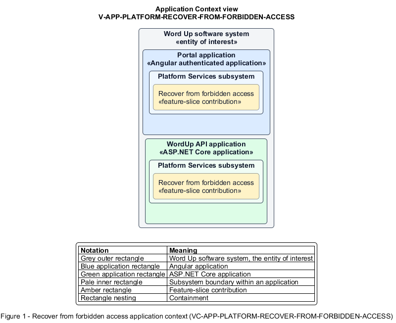

# Recover from forbidden access

## Identification and scope

The Word Up software system is the entity of interest (EoI). The Recover from forbidden access feature slice (`FS-PLATFORM-RECOVER-FROM-FORBIDDEN-ACCESS`) is an architecture description element in the Platform Services subsystem.

| Item | Identification |
| --- | --- |
| Participating applications | Portal application; WordUp API application |
| Architecture view | Application Context view (`V-APP-PLATFORM-RECOVER-FROM-FORBIDDEN-ACCESS`) |
| Governing viewpoint | Application Context viewpoint (`VP-APP-CONTEXT`) |
| View component | Nested Application Context component (`VC-APP-PLATFORM-RECOVER-FROM-FORBIDDEN-ACCESS`) |

This focused description addresses feature scope, behavior, application context, and requirement correspondences. It does not claim conformance as a complete architecture description.

## Overview

The Recover from forbidden access feature slice provides a user a safe next step after an authenticated request is denied.

## Application context

The Application Context view (`V-APP-PLATFORM-RECOVER-FROM-FORBIDDEN-ACCESS`) applies the Application Context viewpoint (`VP-APP-CONTEXT`) to the Word Up software system. The viewpoint frames the application-location concern (`C-APP-LOCATION`). The view component (`VC-APP-PLATFORM-RECOVER-FROM-FORBIDDEN-ACCESS`) uses the nested-containment model kind.

Nested rectangles identify the EoI, each participating application, the subsystem boundary, and the feature-slice contribution. Figure 1 presents the view component.

*Figure 1 — Application Context view: the Recover from forbidden access feature slice within the participating Word Up applications.*

## Behavior

- **Entry.** Authorization rejects an attempted area or resource with 403.
- **Processing.** The response and state disclose no forbidden data, explain that the active role lacks access, and offer Switch account and Back to role home actions.
- **Result.** The user returns to an authorized surface or authenticates as another account.

## Scope boundary

The authorization decision itself belongs to Authentication.

## Correspondences

The requirement-trace correspondence method (`M-REQ-TRACE`) relates stable L2 requirement identifiers to feature slices. The Recover from forbidden access requirement correspondence (`COR-REQ-PLATFORM-RECOVER-FROM-FORBIDDEN-ACCESS`) records the following relationships.

| Requirement | Relationship |
| --- | --- |
| `L2-PLATFORM-006` | Primary requirement |
| `L2-AUTH-009` | Dependency |
