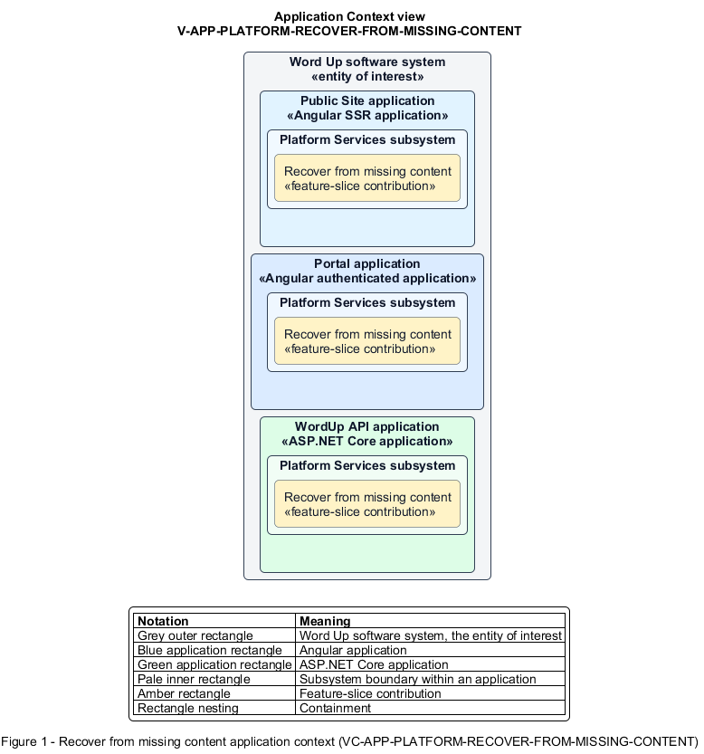

# Recover from missing content

## Identification and scope

The Word Up software system is the entity of interest (EoI). The Recover from missing content feature slice (`FS-PLATFORM-RECOVER-FROM-MISSING-CONTENT`) is an architecture description element in the Platform Services subsystem.

| Item | Identification |
| --- | --- |
| Participating applications | Public Site application; Portal application; WordUp API application |
| Architecture view | Application Context view (`V-APP-PLATFORM-RECOVER-FROM-MISSING-CONTENT`) |
| Governing viewpoint | Application Context viewpoint (`VP-APP-CONTEXT`) |
| View component | Nested Application Context component (`VC-APP-PLATFORM-RECOVER-FROM-MISSING-CONTENT`) |

This focused description addresses feature scope, behavior, application context, and requirement correspondences. It does not claim conformance as a complete architecture description.

## Overview

The Recover from missing content feature slice provides a user a safe route after following a broken, moved, or unknown resource link.

## Application context

The Application Context view (`V-APP-PLATFORM-RECOVER-FROM-MISSING-CONTENT`) applies the Application Context viewpoint (`VP-APP-CONTEXT`) to the Word Up software system. The viewpoint frames the application-location concern (`C-APP-LOCATION`). The view component (`VC-APP-PLATFORM-RECOVER-FROM-MISSING-CONTENT`) uses the nested-containment model kind.

Nested rectangles identify the EoI, each participating application, the subsystem boundary, and the feature-slice contribution. Figure 1 presents the view component.

*Figure 1 — Application Context view: the Recover from missing content feature slice within the participating Word Up applications.*

## Behavior

- **Entry.** Routing or resource lookup determines that the requested target does not exist.
- **Processing.** The application returns a 404 state without leaking lookup details and offers navigation to a role-safe home or sitemap.
- **Result.** The user can continue using the application instead of reaching a dead end.

## Scope boundary

The boundary retains 403 semantics for forbidden resources. Ordinary missing-content handling does not apply when it would leak data.

## Correspondences

The requirement-trace correspondence method (`M-REQ-TRACE`) relates stable L2 requirement identifiers to feature slices. The Recover from missing content requirement correspondence (`COR-REQ-PLATFORM-RECOVER-FROM-MISSING-CONTENT`) records the following relationships.

| Requirement | Relationship |
| --- | --- |
| `L2-PLATFORM-007` | Primary requirement |
