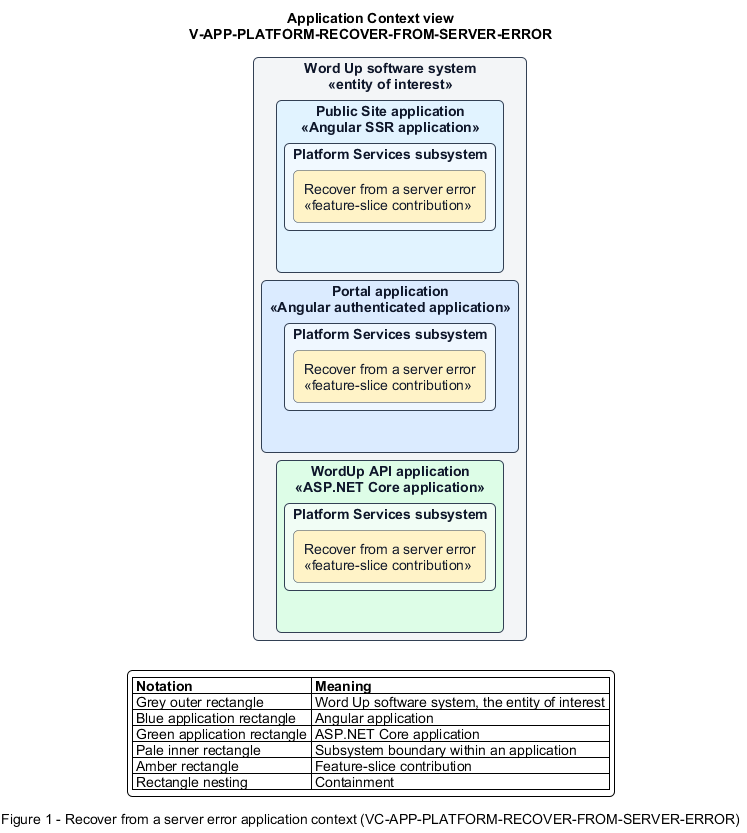

# Recover from a server error

## Identification and scope

The Word Up software system is the entity of interest (EoI). The Recover from a server error feature slice (`FS-PLATFORM-RECOVER-FROM-SERVER-ERROR`) is an architecture description element in the Platform Services subsystem.

| Item | Identification |
| --- | --- |
| Participating applications | Public Site application; Portal application; WordUp API application |
| Architecture view | Application Context view (`V-APP-PLATFORM-RECOVER-FROM-SERVER-ERROR`) |
| Governing viewpoint | Application Context viewpoint (`VP-APP-CONTEXT`) |
| View component | Nested Application Context component (`VC-APP-PLATFORM-RECOVER-FROM-SERVER-ERROR`) |

This focused description addresses feature scope, behavior, application context, and requirement correspondences. It does not claim conformance as a complete architecture description.

## Overview

The Recover from a server error feature slice preserves user trust and work when an unexpected server failure occurs.

## Application context

The Application Context view (`V-APP-PLATFORM-RECOVER-FROM-SERVER-ERROR`) applies the Application Context viewpoint (`VP-APP-CONTEXT`) to the Word Up software system. The viewpoint frames the application-location concern (`C-APP-LOCATION`). The view component (`VC-APP-PLATFORM-RECOVER-FROM-SERVER-ERROR`) uses the nested-containment model kind.

Nested rectangles identify the EoI, each participating application, the subsystem boundary, and the feature-slice contribution. Figure 1 presents the view component.

*Figure 1 — Application Context view: the Recover from a server error feature slice within the participating Word Up applications.*

## Behavior

- **Entry.** A request fails with an unhandled server error.
- **Processing.** The client shows a friendly 500 state with retry and retained in-progress input where possible, while the server hides internals and records correlated error details for alerting.
- **Result.** The user can retry without seeing sensitive diagnostics or unnecessarily losing work.

## Scope boundary

The Operate and Observe System feature slice supplies health monitoring and log transport.

## Correspondences

The requirement-trace correspondence method (`M-REQ-TRACE`) relates stable L2 requirement identifiers to feature slices. The Recover from a server error requirement correspondence (`COR-REQ-PLATFORM-RECOVER-FROM-SERVER-ERROR`) records the following relationships.

| Requirement | Relationship |
| --- | --- |
| `L2-PLATFORM-008` | Primary requirement |
| `L2-NFR-007` | Dependency |
| `L2-NFR-011` | Dependency |
