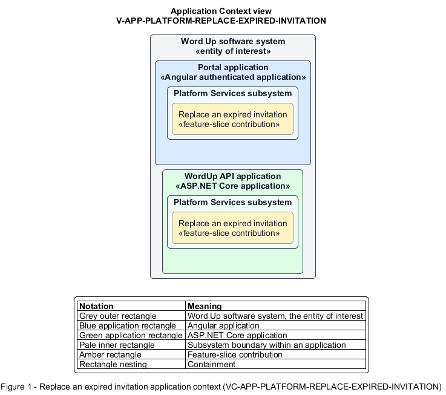

# Replace an expired invitation

## Identification and scope

The Word Up software system is the entity of interest (EoI). The Replace an expired invitation feature slice (`FS-PLATFORM-REPLACE-EXPIRED-INVITATION`) is an architecture description element in the Platform Services subsystem.

| Item | Identification |
| --- | --- |
| Participating applications | Portal application; WordUp API application |
| Architecture view | Application Context view (`V-APP-PLATFORM-REPLACE-EXPIRED-INVITATION`) |
| Governing viewpoint | Application Context viewpoint (`VP-APP-CONTEXT`) |
| View component | Nested Application Context component (`VC-APP-PLATFORM-REPLACE-EXPIRED-INVITATION`) |

This focused description addresses feature scope, behavior, application context, and requirement correspondences. It does not claim conformance as a complete architecture description.

## Overview

The Replace an expired invitation feature slice helps an invitee recover when an activation link is no longer valid.

## Application context

The Application Context view (`V-APP-PLATFORM-REPLACE-EXPIRED-INVITATION`) applies the Application Context viewpoint (`VP-APP-CONTEXT`) to the Word Up software system. The viewpoint frames the application-location concern (`C-APP-LOCATION`). The view component (`VC-APP-PLATFORM-REPLACE-EXPIRED-INVITATION`) uses the nested-containment model kind.

Nested rectangles identify the EoI, each participating application, the subsystem boundary, and the feature-slice contribution. Figure 1 presents the view component.

*Figure 1 — Application Context view: the Replace an expired invitation feature slice within the participating Word Up applications.*

## Behavior

- **Entry.** An invite acceptance request determines that the token has expired.
- **Processing.** The application blocks activation, shows the invite-expired state, and lets the invitee request a replacement from the original inviter without reusing the old token.
- **Result.** The inviter can issue a fresh invitation and the obsolete link remains invalid.

## Scope boundary

Invitation creation, acceptance, resend, and authorization belong to Authentication.

## Correspondences

The requirement-trace correspondence method (`M-REQ-TRACE`) relates stable L2 requirement identifiers to feature slices. The Replace an expired invitation requirement correspondence (`COR-REQ-PLATFORM-REPLACE-EXPIRED-INVITATION`) records the following relationships.

| Requirement | Relationship |
| --- | --- |
| `L2-PLATFORM-011` | Primary requirement |
| `L2-AUTH-004` | Dependency |
