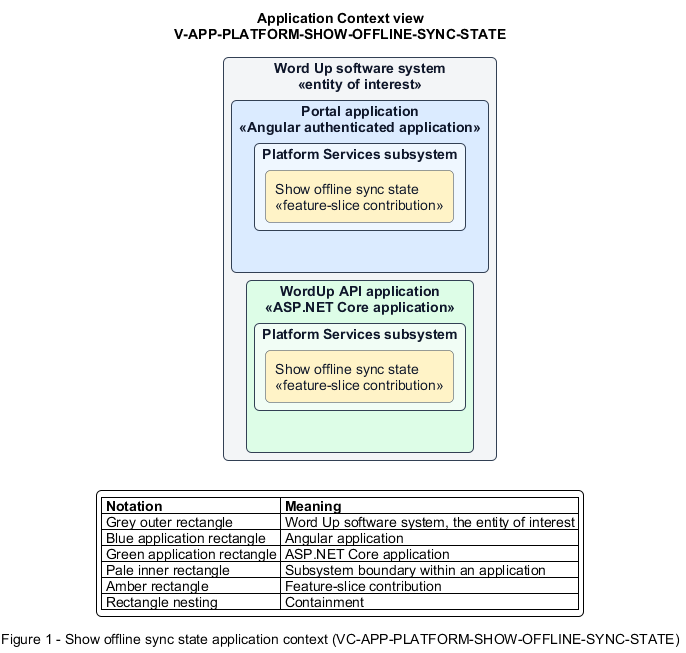

# Show offline sync state

## Identification and scope

The Word Up software system is the entity of interest (EoI). The Show offline sync state feature slice (`FS-PLATFORM-SHOW-OFFLINE-SYNC-STATE`) is an architecture description element in the Platform Services subsystem.

| Item | Identification |
| --- | --- |
| Participating applications | Portal application; WordUp API application |
| Architecture view | Application Context view (`V-APP-PLATFORM-SHOW-OFFLINE-SYNC-STATE`) |
| Governing viewpoint | Application Context viewpoint (`VP-APP-CONTEXT`) |
| View component | Nested Application Context component (`VC-APP-PLATFORM-SHOW-OFFLINE-SYNC-STATE`) |

This focused description addresses feature scope, behavior, application context, and requirement correspondences. It does not claim conformance as a complete architecture description.

## Overview

The Show offline sync state feature slice makes connectivity loss and queued changes visible wherever supported offline work is active.

## Application context

The Application Context view (`V-APP-PLATFORM-SHOW-OFFLINE-SYNC-STATE`) applies the Application Context viewpoint (`VP-APP-CONTEXT`) to the Word Up software system. The viewpoint frames the application-location concern (`C-APP-LOCATION`). The view component (`VC-APP-PLATFORM-SHOW-OFFLINE-SYNC-STATE`) uses the nested-containment model kind.

Nested rectangles identify the EoI, each participating application, the subsystem boundary, and the feature-slice contribution. Figure 1 presents the view component.

*Figure 1 — Application Context view: the Show offline sync state feature slice within the participating Word Up applications.*

## Behavior

- **Entry.** The application detects lost connectivity, pending offline writes, or reconnection.
- **Processing.** A global state keeps already-loaded read-only content usable, shows an offline indicator and queued-change count or summary, and clears the indicator when connectivity returns.
- **Result.** The user knows whether work is local, pending, or reconnected before leaving the page.

## Scope boundary

Version 1 permits offline writes only for attendance. The Sync Attendance Reliably feature slice defines queue replay semantics.

## Correspondences

The requirement-trace correspondence method (`M-REQ-TRACE`) relates stable L2 requirement identifiers to feature slices. The Show offline sync state requirement correspondence (`COR-REQ-PLATFORM-SHOW-OFFLINE-SYNC-STATE`) records the following relationships.

| Requirement | Relationship |
| --- | --- |
| `L2-PLATFORM-012` | Primary requirement |
| `L2-NFR-004` | Dependency |
