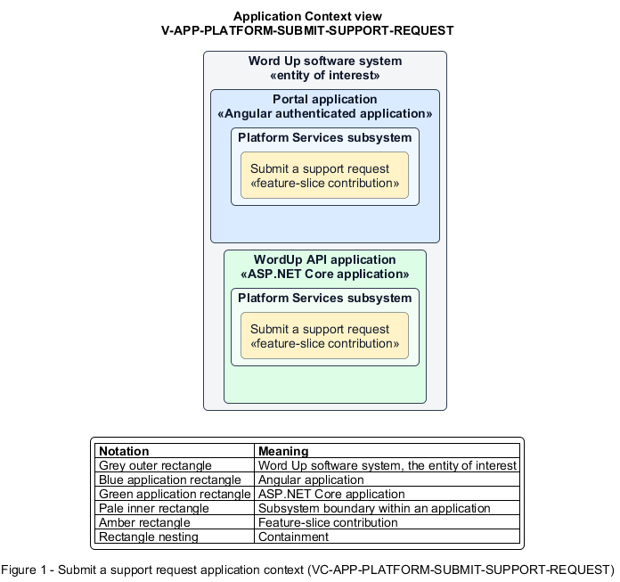

# Submit a support request

## Identification and scope

The Word Up software system is the entity of interest (EoI). The Submit a support request feature slice (`FS-PLATFORM-SUBMIT-SUPPORT-REQUEST`) is an architecture description element in the Platform Services subsystem.

| Item | Identification |
| --- | --- |
| Participating applications | Portal application; WordUp API application |
| Architecture view | Application Context view (`V-APP-PLATFORM-SUBMIT-SUPPORT-REQUEST`) |
| Governing viewpoint | Application Context viewpoint (`VP-APP-CONTEXT`) |
| View component | Nested Application Context component (`VC-APP-PLATFORM-SUBMIT-SUPPORT-REQUEST`) |

This focused description addresses feature scope, behavior, application context, and requirement correspondences. It does not claim conformance as a complete architecture description.

## Overview

The Submit a support request feature slice allows a user send an unresolved problem to program support and receive acknowledgement.

## Application context

The Application Context view (`V-APP-PLATFORM-SUBMIT-SUPPORT-REQUEST`) applies the Application Context viewpoint (`VP-APP-CONTEXT`) to the Word Up software system. The viewpoint frames the application-location concern (`C-APP-LOCATION`). The view component (`VC-APP-PLATFORM-SUBMIT-SUPPORT-REQUEST`) uses the nested-containment model kind.

Nested rectangles identify the EoI, each participating application, the subsystem boundary, and the feature-slice contribution. Figure 1 presents the view component.

*Figure 1 — Application Context view: the Submit a support request feature slice within the participating Word Up applications.*

## Behavior

- **Entry.** A user enters a category, description, reply-to email, and optional screenshot.
- **Processing.** The API validates required text and safe JPG/PNG upload limits, persists the request, emails it to the director's support inbox, and avoids exposing internal delivery details.
- **Result.** The user sees confirmation that support received the request.

## Scope boundary

Help content browsing and any downstream support workflow are outside this slice.

## Correspondences

The requirement-trace correspondence method (`M-REQ-TRACE`) relates stable L2 requirement identifiers to feature slices. The Submit a support request requirement correspondence (`COR-REQ-PLATFORM-SUBMIT-SUPPORT-REQUEST`) records the following relationships.

| Requirement | Relationship |
| --- | --- |
| `L2-PLATFORM-005` | Primary requirement |
| `L2-NFR-001` | Dependency |
