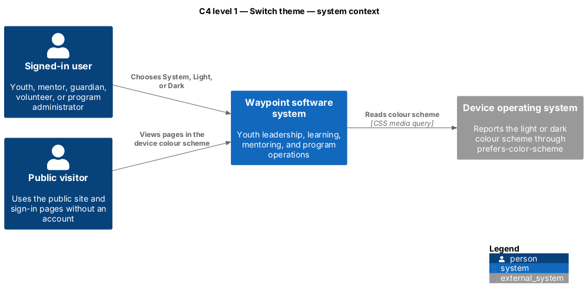
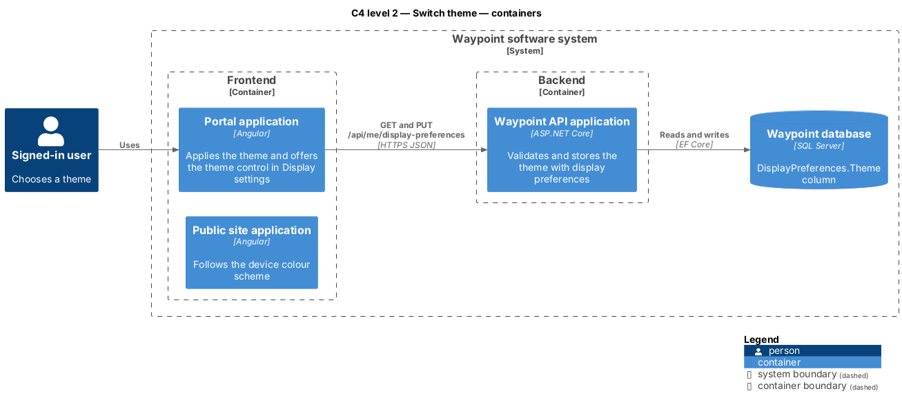
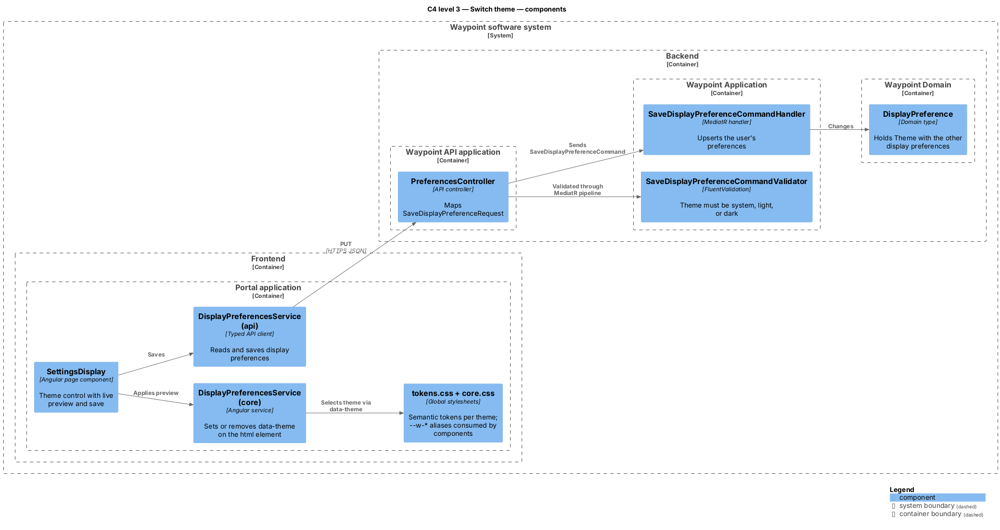
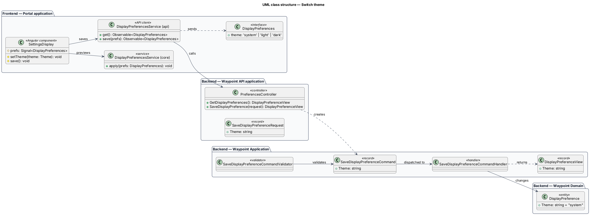
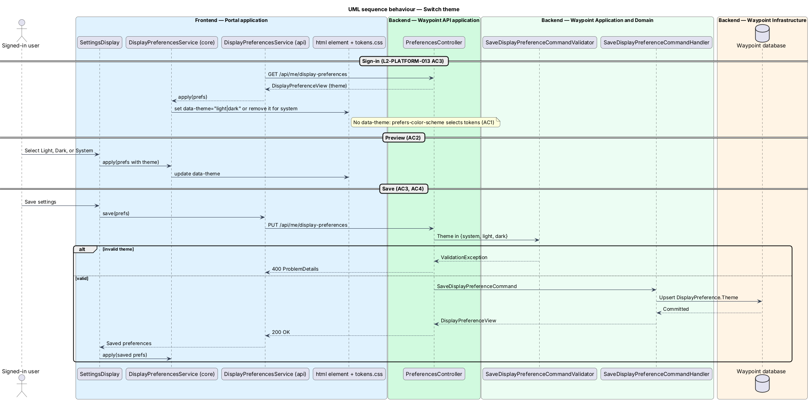

# Switch theme

## Overview

Waypoint is a youth-leadership software system for program intake, learning, mentoring, safeguarding, and program operations. The Platform Services subsystem owns this feature slice.

A *theme* is a complete set of colour values for every surface, text, border, and state in the user interface. Waypoint ships two themes: *light* and *dark*. A *design token* is a named CSS custom property, such as `--color-bg-canvas`, that a component reads instead of a literal colour. Because every component reads tokens, switching the theme changes the token values in one place and every page follows.

Each user holds a *theme preference* with one of three values. `system`, the default, follows the device colour scheme that the browser reports through the `prefers-color-scheme` media query. `light` and `dark` override the device. Signed-out pages — the public site and the sign-in pages — have no saved preference and always follow the device.

The theme preference is stored with the other display and accessibility preferences configured by the [Configure display preferences](../configure-display/README.md) slice, and it is applied in the same way: as a hook on the document root element.

## Description

### Token tiers

The frontend loads the design-system token file as [`tokens.css`](../../../../frontend/projects/components/src/styles/tokens.css), a copy of [`docs/design-system/tokens/tokens.css`](../../../design-system/tokens/tokens.css). It has three tiers:

1. **Primitives** (`--palette-*`) hold raw values and never change per theme.
2. **Semantic tokens** (`--color-*`, `--shadow-*`) name a role, such as canvas, muted text, or border. The `:root` block holds light values. A `[data-theme="dark"]` block, and the same block inside `@media (prefers-color-scheme: dark)` guarded by `:root:not([data-theme="light"])`, hold dark values.
3. **Component aliases** (`--w-*`) in [`core.css`](../../../../frontend/projects/components/src/styles/core.css) are the names every existing component rule reads. Each colour alias resolves to a semantic token, so components inherit the theme without per-component dark rules.

Ink alpha tints (`--w-ink-80` … `--w-ink-04`) are derived with `color-mix()` from `--color-fg-default`, so a tint of dark ink in light becomes a tint of light ink in dark. Text placed on a lime fill reads `--w-on-lime` (`--color-fg-on-brand`), which stays dark ink in both themes. Accent and avatar hues (`--w-green`, `--w-sky`, …) are decorative and identical in both themes.

The high-contrast class `w-a11y-contrast` in [`a11y.css`](../../../../frontend/projects/components/src/styles/a11y.css) also derives its stronger borders and text from `--color-fg-default`, so it strengthens either theme.

### Components and types

| Layer | Components, types, and classes | Responsibility |
| --- | --- | --- |
| Global styles | [`tokens.css`](../../../../frontend/projects/components/src/styles/tokens.css), [`core.css`](../../../../frontend/projects/components/src/styles/core.css), [`a11y.css`](../../../../frontend/projects/components/src/styles/a11y.css) | Define light and dark token values and map component aliases onto them. Loaded by the portal, the public site, and Storybook. |
| Frontend page | [`SettingsDisplay`](../../../../frontend/projects/account/src/lib/settings/display/settings-display.ts) | Shows a three-option theme control (System, Light, Dark), previews the selection, and saves it with the other preferences. |
| Frontend service | [`DisplayPreferencesService`](../../../../frontend/projects/core/src/lib/display-preferences.service.ts) (core) | Sets `data-theme="light"` or `data-theme="dark"` on `<html>`, or removes the attribute for `system`. |
| Frontend API boundary | [`DisplayPreferencesService`](../../../../frontend/projects/api/src/lib/services/display-preferences.service.ts) (api), [`DisplayPreferences`](../../../../frontend/projects/api/src/lib/models/preferences/display-preferences.ts) | Carries `theme: 'system' \| 'light' \| 'dark'` on `GET` and `PUT /api/me/display-preferences`. |
| API transport | [`PreferencesController`](../../../../backend/src/Waypoint.Api/Controllers/PlatformServices/PreferencesController.cs), [`SaveDisplayPreferenceRequest`](../../../../backend/src/Waypoint.Api/Contracts/PlatformServices/SaveDisplayPreferenceRequest.cs) | Maps the optional `Theme` field; an omitted theme saves as `system`. |
| Application slice | [`SaveDisplayPreferenceCommand`](../../../../backend/src/Waypoint.Application/PlatformServices/DisplayPreferences/SaveDisplayPreferenceCommand.cs), [`SaveDisplayPreferenceCommandValidator`](../../../../backend/src/Waypoint.Application/PlatformServices/DisplayPreferences/SaveDisplayPreferenceCommandValidator.cs), [`SaveDisplayPreferenceCommandHandler`](../../../../backend/src/Waypoint.Application/PlatformServices/DisplayPreferences/SaveDisplayPreferenceCommandHandler.cs), [`DisplayPreferenceView`](../../../../backend/src/Waypoint.Application/PlatformServices/DisplayPreferences/DisplayPreferenceQuery.cs) | Reject any theme other than `system`, `light`, or `dark` with a 400 validation error; upsert and return the theme. |
| Domain state | [`DisplayPreference`](../../../../backend/src/Waypoint.Domain/PlatformServices/DisplayPreference.cs) | Holds `Theme` (string, maximum 16 characters, default `system`). A migration adds the column with default `system` for existing rows. |

### Behavior

1. **Signed out or no preference.** No `data-theme` attribute is present. The `prefers-color-scheme` media query selects the light or dark token values (`L2-PLATFORM-013` AC1).
2. **Sign-in.** The portal shell loads display preferences and applies them. A saved `light` or `dark` theme sets `data-theme` and overrides the device (AC3).
3. **Preview.** Selecting an option on Display settings applies it immediately without a request (AC2).
4. **Save.** Saving sends the theme with the other preferences. The validator rejects an unknown theme with a 400 response and stores nothing (AC4).
5. **Native controls.** Each theme block sets `color-scheme`, so scrollbars and form controls match the theme (AC5).

## Requirements

| L2 ID | Refines (L1) | Requirement |
|-------|--------------|-------------|
| `L2-PLATFORM-013` | `L1-PLATFORM-002` | Every page shall render from one set of design tokens in a light theme and a dark theme. Each user shall choose System, Light, or Dark; System follows the device colour scheme and is the default. |
| `L2-PLATFORM-004` | `L1-PLATFORM-002` | Users shall set text size, high contrast, reduced motion, underline links, and reading font. |
| `L2-NFR-010` | `L1-NFR-007` | The UI shall be operable and perceivable per WCAG 2.1 AA. |

## Diagrams

Figure 1 places the feature in its environment. The device operating system is an external source: it supplies the colour scheme that `system` follows.

Figure 2 shows that only the portal stores a preference. The public site follows the device and calls no theme endpoint.

Figure 3 locates the theme control, the root-attribute service, and the global token stylesheets, and shows that validation runs in the MediatR pipeline before the handler.

Figure 4 shows the `theme` field on each type it passes through, from the frontend model to the domain entity.

Figure 5 shows the three interactions: applying the saved theme at sign-in, previewing a selection, and saving it, including the 400 path for an invalid theme.

