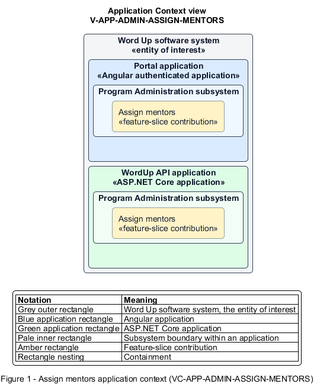

# Assign mentors

## Identification and scope

The Word Up software system is the entity of interest (EoI). The Assign mentors feature slice (`FS-ADMIN-ASSIGN-MENTORS`) is an architecture description element in the Program Administration subsystem.

| Item | Identification |
| --- | --- |
| Participating applications | Portal application; WordUp API application |
| Architecture view | Application Context view (`V-APP-ADMIN-ASSIGN-MENTORS`) |
| Governing viewpoint | Application Context viewpoint (`VP-APP-CONTEXT`) |
| View component | Nested Application Context component (`VC-APP-ADMIN-ASSIGN-MENTORS`) |

This focused description addresses feature scope, behavior, application context, and requirement correspondences. It does not claim conformance as a complete architecture description.

## Overview

The Assign mentors feature slice allows administrators maintain mentor-to-youth and mentor-to-cohort relationships with visible caseload impact.

## Application context

The Application Context view (`V-APP-ADMIN-ASSIGN-MENTORS`) applies the Application Context viewpoint (`VP-APP-CONTEXT`) to the Word Up software system. The viewpoint frames the application-location concern (`C-APP-LOCATION`). The view component (`VC-APP-ADMIN-ASSIGN-MENTORS`) uses the nested-containment model kind.

Nested rectangles identify the EoI, each participating application, the subsystem boundary, and the feature-slice contribution. Figure 1 presents the view component.

*Figure 1 — Application Context view: the Assign mentors feature slice within the participating Word Up applications.*

## Behavior

- **Entry.** An administrator opens the assignment tool for a youth, mentor, or cohort.
- **Processing.** The server updates the youth's assigned mentor or a cohort's lead and supporting mentors, supports different mentor designations across cohorts, and recomputes scoped rosters and caseload indicators.
- **Result.** Mentor access and dashboards immediately reflect the new assignments and overload can be identified.

## Scope boundary

Staff activity reporting and role changes are separate slices.

## Correspondences

The requirement-trace correspondence method (`M-REQ-TRACE`) relates stable L2 requirement identifiers to feature slices. The Assign mentors requirement correspondence (`COR-REQ-ADMIN-ASSIGN-MENTORS`) records the following relationships.

| Requirement | Relationship |
| --- | --- |
| `L2-ADMIN-005` | Primary requirement |
| `L2-AUTH-010` | Dependency |
| `L2-REPORT-001` | Dependency |
