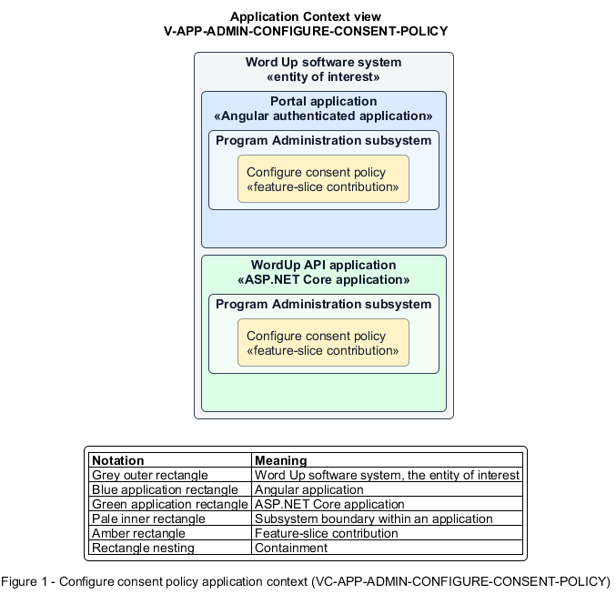

# Configure consent policy

## Identification and scope

The Word Up software system is the entity of interest (EoI). The Configure consent policy feature slice (`FS-ADMIN-CONFIGURE-CONSENT-POLICY`) is an architecture description element in the Program Administration subsystem.

| Item | Identification |
| --- | --- |
| Participating applications | Portal application; WordUp API application |
| Architecture view | Application Context view (`V-APP-ADMIN-CONFIGURE-CONSENT-POLICY`) |
| Governing viewpoint | Application Context viewpoint (`VP-APP-CONTEXT`) |
| View component | Nested Application Context component (`VC-APP-ADMIN-CONFIGURE-CONSENT-POLICY`) |

This focused description addresses feature scope, behavior, application context, and requirement correspondences. It does not claim conformance as a complete architecture description.

## Overview

The Configure consent policy feature slice allows administrators define the organization rules that drive guardian consent journeys.

## Application context

The Application Context view (`V-APP-ADMIN-CONFIGURE-CONSENT-POLICY`) applies the Application Context viewpoint (`VP-APP-CONTEXT`) to the Word Up software system. The viewpoint frames the application-location concern (`C-APP-LOCATION`). The view component (`VC-APP-ADMIN-CONFIGURE-CONSENT-POLICY`) uses the nested-containment model kind.

Nested rectangles identify the EoI, each participating application, the subsystem boundary, and the feature-slice contribution. Figure 1 presents the view component.

*Figure 1 — Application Context view: the Configure consent policy feature slice within the participating Word Up applications.*

## Behavior

- **Entry.** An administrator edits consent statement text, per-term renewal, or required media-consent settings.
- **Processing.** The server authorizes, validates, persists, and audits the policy; consent capture and access gating consume the active version and term context.
- **Result.** New and renewed consent experiences enforce the organization's current policy consistently.

## Scope boundary

Guardians provide consent and youth access is gated in Consent and Safeguarding.

## Correspondences

The requirement-trace correspondence method (`M-REQ-TRACE`) relates stable L2 requirement identifiers to feature slices. The Configure consent policy requirement correspondence (`COR-REQ-ADMIN-CONFIGURE-CONSENT-POLICY`) records the following relationships.

| Requirement | Relationship |
| --- | --- |
| `L2-ADMIN-006` | Primary requirement |
| `L2-CONSENT-001` | Dependency |
| `L2-CONSENT-002` | Dependency |
| `L2-CONSENT-003` | Dependency |
