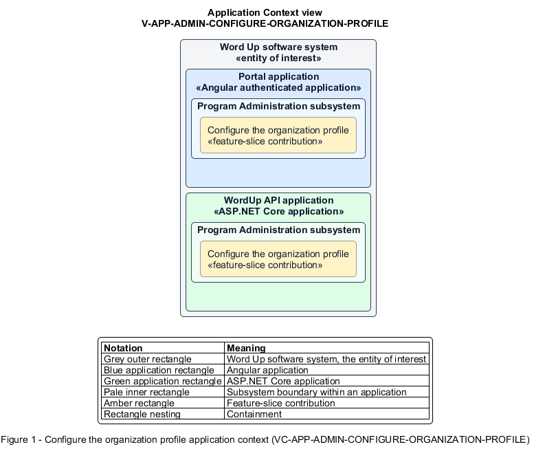

# Configure the organization profile

## Identification and scope

The Word Up software system is the entity of interest (EoI). The Configure the organization profile feature slice (`FS-ADMIN-CONFIGURE-ORGANIZATION-PROFILE`) is an architecture description element in the Program Administration subsystem.

| Item | Identification |
| --- | --- |
| Participating applications | Portal application; WordUp API application |
| Architecture view | Application Context view (`V-APP-ADMIN-CONFIGURE-ORGANIZATION-PROFILE`) |
| Governing viewpoint | Application Context viewpoint (`VP-APP-CONTEXT`) |
| View component | Nested Application Context component (`VC-APP-ADMIN-CONFIGURE-ORGANIZATION-PROFILE`) |

This focused description addresses feature scope, behavior, application context, and requirement correspondences. It does not claim conformance as a complete architecture description.

## Overview

The Configure the organization profile feature slice allows a Program Administrator maintain the identity and contact details displayed across the platform.

## Application context

The Application Context view (`V-APP-ADMIN-CONFIGURE-ORGANIZATION-PROFILE`) applies the Application Context viewpoint (`VP-APP-CONTEXT`) to the Word Up software system. The viewpoint frames the application-location concern (`C-APP-LOCATION`). The view component (`VC-APP-ADMIN-CONFIGURE-ORGANIZATION-PROFILE`) uses the nested-containment model kind.

Nested rectangles identify the EoI, each participating application, the subsystem boundary, and the feature-slice contribution. Figure 1 presents the view component.

*Figure 1 — Application Context view: the Configure the organization profile feature slice within the participating Word Up applications.*

## Behavior

- **Entry.** An administrator edits organization name, display name, logo, city, or contact email.
- **Processing.** The form validates fields and safe logo upload, the server authorizes and persists the fixed-palette organization identity, and the change is audit-logged.
- **Result.** Public and consent-facing surfaces use the current organization details and guardian contact email.

## Scope boundary

The platform color palette is not tenant-configurable.

## Correspondences

The requirement-trace correspondence method (`M-REQ-TRACE`) relates stable L2 requirement identifiers to feature slices. The Configure the organization profile requirement correspondence (`COR-REQ-ADMIN-CONFIGURE-ORGANIZATION-PROFILE`) records the following relationships.

| Requirement | Relationship |
| --- | --- |
| `L2-ADMIN-006` | Primary requirement |
| `L2-AUTH-009` | Dependency |
| `L2-CONSENT-003` | Dependency |
| `L2-NFR-001` | Dependency |
