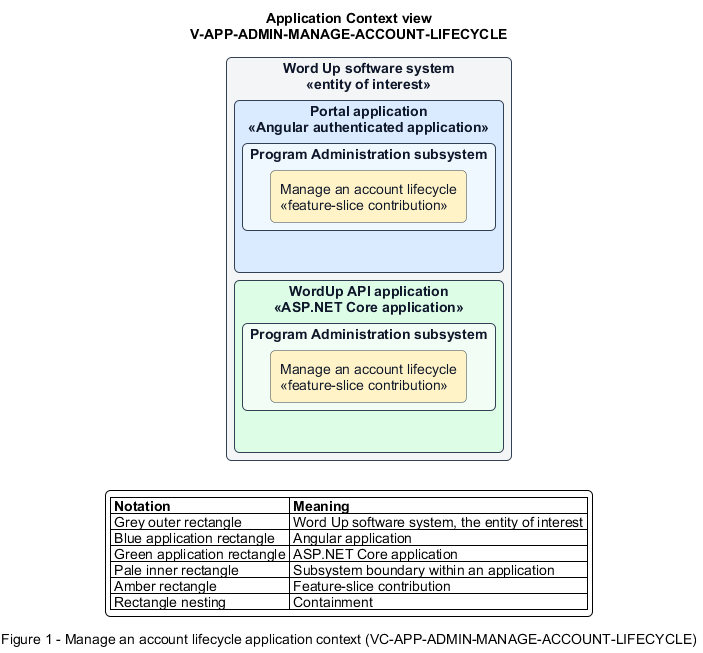

# Manage an account lifecycle

## Identification and scope

The Word Up software system is the entity of interest (EoI). The Manage an account lifecycle feature slice (`FS-ADMIN-MANAGE-ACCOUNT-LIFECYCLE`) is an architecture description element in the Program Administration subsystem.

| Item | Identification |
| --- | --- |
| Participating applications | Portal application; WordUp API application |
| Architecture view | Application Context view (`V-APP-ADMIN-MANAGE-ACCOUNT-LIFECYCLE`) |
| Governing viewpoint | Application Context viewpoint (`VP-APP-CONTEXT`) |
| View component | Nested Application Context component (`VC-APP-ADMIN-MANAGE-ACCOUNT-LIFECYCLE`) |

This focused description addresses feature scope, behavior, application context, and requirement correspondences. It does not claim conformance as a complete architecture description.

## Overview

The Manage an account lifecycle feature slice allows administrators change role, send password recovery, deactivate or reactivate access, and irreversibly remove active use with correct retention.

## Application context

The Application Context view (`V-APP-ADMIN-MANAGE-ACCOUNT-LIFECYCLE`) applies the Application Context viewpoint (`VP-APP-CONTEXT`) to the Word Up software system. The viewpoint frames the application-location concern (`C-APP-LOCATION`). The view component (`VC-APP-ADMIN-MANAGE-ACCOUNT-LIFECYCLE`) uses the nested-containment model kind.

Nested rectangles identify the EoI, each participating application, the subsystem boundary, and the feature-slice contribution. Figure 1 presents the view component.

*Figure 1 — Application Context view: the Manage an account lifecycle feature slice within the participating Word Up applications.*

## Behavior

- **Entry.** An administrator chooses an account action from a person record and confirms any warnings.
- **Processing.** The server authorizes and audits the action and revokes affected sessions. The Portal application warns before staff-role elevation. The server retains progress for deactivation or removal, permits reactivation only after deactivation, and emails reset links.
- **Result.** Access and role state change immediately while retained reporting records follow policy.

## Scope boundary

Editing profile data and fulfilling data-subject removal requests remain separate concerns.

## Correspondences

The requirement-trace correspondence method (`M-REQ-TRACE`) relates stable L2 requirement identifiers to feature slices. The Manage an account lifecycle requirement correspondence (`COR-REQ-ADMIN-MANAGE-ACCOUNT-LIFECYCLE`) records the following relationships.

| Requirement | Relationship |
| --- | --- |
| `L2-ADMIN-002` | Primary requirement |
| `L2-AUTH-005` | Dependency |
| `L2-AUTH-009` | Dependency |
| `L2-CONSENT-003` | Dependency |
