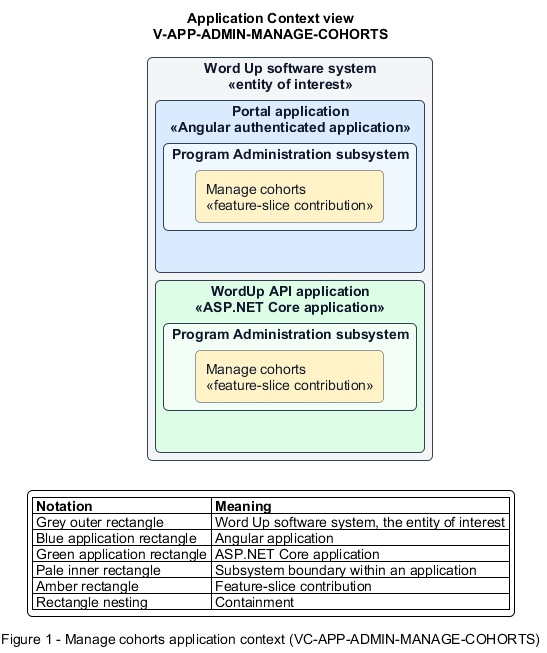

# Manage cohorts

## Identification and scope

The Word Up software system is the entity of interest (EoI). The Manage cohorts feature slice (`FS-ADMIN-MANAGE-COHORTS`) is an architecture description element in the Program Administration subsystem.

| Item | Identification |
| --- | --- |
| Participating applications | Portal application; WordUp API application |
| Architecture view | Application Context view (`V-APP-ADMIN-MANAGE-COHORTS`) |
| Governing viewpoint | Application Context viewpoint (`VP-APP-CONTEXT`) |
| View component | Nested Application Context component (`VC-APP-ADMIN-MANAGE-COHORTS`) |

This focused description addresses feature scope, behavior, application context, and requirement correspondences. It does not claim conformance as a complete architecture description.

## Overview

The Manage cohorts feature slice allows administrators create a cohort, maintain its core details, and enroll existing or invited youth.

## Application context

The Application Context view (`V-APP-ADMIN-MANAGE-COHORTS`) applies the Application Context viewpoint (`VP-APP-CONTEXT`) to the Word Up software system. The viewpoint frames the application-location concern (`C-APP-LOCATION`). The view component (`VC-APP-ADMIN-MANAGE-COHORTS`) uses the nested-containment model kind.

Nested rectangles identify the EoI, each participating application, the subsystem boundary, and the feature-slice contribution. Figure 1 presents the view component.

*Figure 1 — Application Context view: the Manage cohorts feature slice within the participating Word Up applications.*

## Behavior

- **Entry.** An administrator creates or opens a cohort.
- **Processing.** The forms require a name, track, and lead mentor and capture dates and location. The API adds selected youth or starts invitation, updates membership counts, and audits edits. The Portal application presents empty, retry, and error states.
- **Result.** The cohort has current leadership, schedule context, track, and membership available to dependent features.

## Scope boundary

Assigning supporting mentor relationships and scheduling sessions are separate slices.

## Correspondences

The requirement-trace correspondence method (`M-REQ-TRACE`) relates stable L2 requirement identifiers to feature slices. The Manage cohorts requirement correspondence (`COR-REQ-ADMIN-MANAGE-COHORTS`) records the following relationships.

| Requirement | Relationship |
| --- | --- |
| `L2-ADMIN-003` | Primary requirement |
| `L2-AUTH-003` | Dependency |
| `L2-CONSENT-003` | Dependency |
